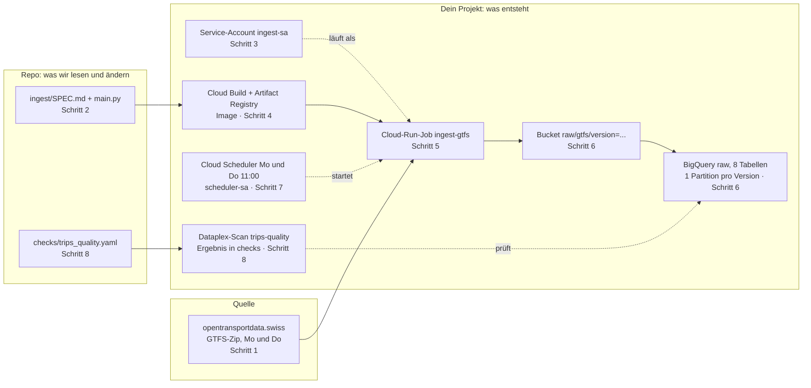

# Lektion 1: Daten rein, wiederholbar

## Worum es geht

Im [Tutorial zur Datenanalyse](https://github.com/vp-82/daeng-hs26/blob/main/TUTORIAL.md)
hast du die Frage beantwortet: Wie viele Fahrten fährt jede Linie pro Tag? Explorativ, auf
dem Laptop, mit einer lokalen Pipeline aus DuckDB und dbt. Diese zwei Lektionen bauen
dieselbe Pipeline noch einmal, diesmal so, wie sie in einem Unternehmen laufen würde: auf
Google Cloud, ohne Laptop, jeden Montag von selbst, geprüft. Das ist die Frage, die ein
Unternehmen nach der Analyse stellt: Wie wird diese Antwort produziert, ohne dass jemand
etwas anfasst, und woher wissen wir, dass sie stimmt? Das Analyse-Tutorial ist keine
Voraussetzung für heute, aber wer es gemacht hat, erkennt jeden Schritt wieder.

Lektion 1 beantwortet die erste Hälfte. Am Ende läuft in deinem Projekt ein Job, der den
Schweizer Fahrplan vom Publisher holt, unverändert ablegt, in BigQuery lädt, zweimal pro Woche
von selbst startet, und dessen Rohdaten geprüft werden. Lektion 2 macht aus den Rohdaten die
Antwort.

Die Zahlen aus dem Fahrplan spielen heute keine Rolle. Es geht um den Weg, nicht um das
Ergebnis.

## Die Karte

Jeder Kasten entsteht in einem Schritt dieser Lektion. Wenn Claude Code gerade arbeitet, zeigt
die Karte, wo wir stehen.



## Wie die Lektion funktioniert

Jeder Schritt hat dieselbe Form: ein kurzes Warum, ein Prompt für Claude Code, die Befehle,
die Claude Code daraus machen wird, und ein Blick in die Console, der zeigt, dass es geklappt
hat. Du fügst den Prompt ein, liest jeden Befehl, den Claude Code dir zur Freigabe zeigt,
vergleichst ihn mit der Liste, und gibst frei. Dann schaust du in der Console nach.

Claude Code läuft dabei im Auto-Modus (`auto mode on` unter der Eingabezeile): Ein zweites
Modell prüft jeden Befehl und lässt durch, was zum Prompt passt, du liest mit. Sperrt es einen
Befehl, meist einen Deploy oder ein neues Recht, zeigt Claude Code ihn dir mit `!` am Anfang.
Vergleiche ihn mit der Liste, und wenn er stimmt, führ ihn mit dieser Zeile selbst aus.

Wer die Aufzeichnung schaut: Jeder Schritt ist in sich abgeschlossen. Pausiere nach jedem
Console-Check und vergleiche.

## Wie die Prompts aufgebaut sind

Die Prompts in diesem Kurs haben vier Teile, auch wenn sie kurz sind: was das Ding tun soll,
welche Entscheidungen fest sind, weil andere Teile davon abhängen (Namen, Regionen, Rechte),
was der Agent nicht tun soll, und woran wir sehen, dass es geklappt hat. Der Code in
`ingest/` ist genau so entstanden: `ingest/SPEC.md` ist der Prompt, `ingest/main.py` die
Antwort von Claude Code, geprüft und dann ins Repo übernommen. In einem Team stünden
dieselben vier Teile in einem Issue, mit Tests dran. Wie das aussieht, steht in
[SPEC-IM-TEAM.md](SPEC-IM-TEAM.md). Heute geht es um die Pipeline.

## Bevor es losgeht

Das Repo hat sich seit der Vorbereitung geändert. Im Terminal, im Ordner `daeng-hs26-gcp`:

```bash
git pull
claude
```

Claude Code neu starten ist nötig, damit es die neue `.claude/settings.json` liest.

Die Anmeldung von gcloud läuft bei ZHAW-Konten nach einigen Stunden ab. Melde dich vor der
Lektion neu an, dann unterbricht es dich nicht mittendrin. Beide Male öffnet sich der
Browser, beide Male das ZHAW-Konto wählen:

```bash
gcloud auth login
gcloud auth application-default login
```

Dein Projekt in der Console findest du über die Projektauswahl oben links, Tab **Alle**,
unterhalb der Organisation `zhaw.ch`. In der Liste "Zuletzt verwendet" steht es erst, wenn du
es einmal geöffnet hast. Die Console-Links in dieser Anleitung öffnen das zuletzt gewählte
Projekt. Prüfe oben links, dass es deines ist.

---

## 1. Die Quelle

**Warum.** Daten kommen nicht aus einer Datei auf deinem Laptop, sondern von einem System, das
jemand anderes betreibt. Der Schweizer Fahrplan wird von opentransportdata.swiss als GTFS-Zip
veröffentlicht, zweimal pro Woche, Montag und Donnerstag zwischen 9 und 10 Uhr. Die Zip ist
rund 290 MB gross, entpackt 4,5 GB, davon allein `stop_times.txt` 3,7 GB.

Öffne im Browser https://data.opentransportdata.swiss/dataset/timetable-2026-gtfs2020. Du
siehst die Liste der Versionen, die neueste zuoberst, und ganz unten den Permalink "zur
aktuellen Quelle". Den Permalink benutzt unser Job. Er leitet zweimal weiter, zuletzt auf eine
signierte URL, die 60 Sekunden gültig ist. Der Job holt die Datei deshalb mit einem einzigen
GET und folgt den Weiterleitungen.

Kein Prompt in diesem Schritt.

---

## 2. Den Job lesen

**Warum.** Du musst den Code nicht schreiben können, aber du musst wissen, was er tut, bevor
du ihn in der Cloud laufen lässt. Der Job macht zwei Dinge nacheinander: Er holt die Daten
vom Publisher und legt sie im Bucket ab, und er lädt sie aus dem Bucket nach BigQuery. Die
Trennung ist Absicht. Der Bucket hält das Original, BigQuery lässt sich daraus jederzeit neu
füllen, ohne den Publisher nochmals zu fragen.

Drei Entscheidungen im Code sind Data Engineering, nicht Python: Die Zip wird unverändert
abgelegt (Landing Zone, was ankam bleibt erhalten). Jede Feed-Version landet in einer eigenen
Partition, und ein zweiter Lauf derselben Version ersetzt genau diese Partition. Alle Spalten
bleiben Text, Typen bekommen die Daten erst in der Transformation, weil GTFS Zeiten wie
25:30:00 enthält.

**Was eine Partition ist.** Eine BigQuery-Tabelle kann in Stücke geteilt sein, hier eines pro
Tag. Jedes Stück lässt sich einzeln schreiben, ersetzen oder löschen, und eine Abfrage, die
nach dem Datum filtert, liest nur dieses Stück und zahlt nur dafür. Unser Job legt pro
Feed-Version eine Partition an, benannt nach dem Datum der Version. Ein zweiter Lauf
derselben Version ersetzt genau diese Partition, eine neue Version kommt daneben zu liegen.
Partitionen verfallen nach 90 Tagen, gerechnet ab dem Datum der Version, nicht ab dem Tag des
Ladens.

**Warum der Code schon da ist.** Damit alle denselben Job deployen und die Lektion nicht an
fünf verschiedenen Fassungen hängt. Entstanden ist er so, wie du es in Schritt 8 mit den
Regeln selbst machst: Spezifikation an Claude Code, Code zurück, gelesen, zwei Dinge
korrigiert, committet. In einem Team wäre die Spezifikation ein Issue, der Code käme als Pull
Request von wem auch immer ihn schreibt, Mensch oder Agent, und erst nach einem Review ins
Repo. Das Repo ist die Quelle der Wahrheit, nicht der Chat.

Prompt:

```text
Lies ingest/SPEC.md und ingest/main.py. Erkläre mir in fünf Punkten, was der Job tut, einen
Punkt pro Schritt, und nenne mir zu jedem Schritt die Funktion in main.py, die ihn ausführt.
Danach erkläre mir das Dockerfile in zwei Sätzen. Ändere nichts.
```

Kein Befehl, nur Lesen. Was du danach wissen solltest: welche fünf Schritte der Job macht, was
`raw/gtfs/version=<version>/` im Bucket bedeutet, und dass das Dockerfile die Box beschreibt,
in der das Skript läuft: Python, drei Bibliotheken, `main.py`.

---

## 3. Identitäten

**Warum.** In Google Cloud handelt nie "das Projekt", sondern immer eine Identität. Der Job
braucht eine eigene, mit genau den Rechten, die er braucht und keinen mehr: Dateien in einen
Bucket schreiben, Tabellen in BigQuery anlegen, Load-Jobs starten. Das heisst Least Privilege.
Und auch das Bauen des Containers läuft als Identität, das Compute-Standardkonto, das in neuen
Projekten absichtlich keine Rechte hat. Es bekommt die eine Rolle, die zum Bauen nötig ist.

Prompt 1:

```text
Lege einen Service-Account ingest-sa für den Ingest-Job an. Er bekommt genau drei Rechte:
BigQuery Data Editor und BigQuery Job User auf dem Projekt, Storage Object Admin nur auf dem
Bucket <projekt-id>-raw, nicht auf dem Projekt. Warte nach dem Anlegen, bis
gcloud iam service-accounts describe den Account zeigt, und vergib erst dann die Rechte.
Zeige mir am Ende, nur lesend, welche Rechte er auf dem Projekt und auf dem Bucket hat.
```

Prompt 2:

```text
Der nächste Schritt baut ein Container-Image aus ingest/. Der Build läuft als
Compute-Standardkonto des Projekts (Projektnummer-compute@developer.gserviceaccount.com).
Gib diesem Konto die Rolle Cloud Run Builder auf dem Projekt, sonst nichts. Erkläre mir in
einem Satz, warum das nötig ist.
```

Diese Befehle zeigt dir Claude Code zur Freigabe, die IDs sind bei dir andere:

```bash
gcloud iam service-accounts create ingest-sa --display-name="Ingest-Job GTFS"

gcloud iam service-accounts describe \
  ingest-sa@daeng-KÜRZEL-XXXX.iam.gserviceaccount.com

gcloud projects add-iam-policy-binding daeng-KÜRZEL-XXXX \
  --member="serviceAccount:ingest-sa@daeng-KÜRZEL-XXXX.iam.gserviceaccount.com" \
  --role="roles/bigquery.dataEditor"

gcloud projects add-iam-policy-binding daeng-KÜRZEL-XXXX \
  --member="serviceAccount:ingest-sa@daeng-KÜRZEL-XXXX.iam.gserviceaccount.com" \
  --role="roles/bigquery.jobUser"

gcloud storage buckets add-iam-policy-binding gs://daeng-KÜRZEL-XXXX-raw \
  --member="serviceAccount:ingest-sa@daeng-KÜRZEL-XXXX.iam.gserviceaccount.com" \
  --role="roles/storage.objectAdmin"

gcloud projects add-iam-policy-binding daeng-KÜRZEL-XXXX \
  --member="serviceAccount:PROJEKTNUMMER-compute@developer.gserviceaccount.com" \
  --role="roles/run.builder"
```

Console: [IAM und Verwaltung → Dienstkonten](https://console.cloud.google.com/iam-admin/serviceaccounts)
zeigt `ingest-sa`. [IAM und Verwaltung → IAM](https://console.cloud.google.com/iam-admin/iam)
zeigt `ingest-sa` mit zwei Rollen und das Compute-Standardkonto mit "Cloud Run Builder".

Checkpoint: Claude Code hat dir die Rechte auf dem Bucket angezeigt, genau eine Zeile mit
`roles/storage.objectAdmin`.

---

## 4. Bauen und deployen

**Warum.** Der Job läuft nicht auf deinem Rechner, sondern als Container in Cloud Run. Aus
dem Dockerfile baut Cloud Build ein Image, legt es in Artifact Registry ab, und Cloud Run
führt es als Job aus: starten, arbeiten, beenden. Ein Job hat keinen Server, der wartet, und
kostet nichts, wenn er nicht läuft.

Prompt:

```text
Lege in Artifact Registry eine Docker-Ablage namens cloud-run-source-deploy in europe-west6
an. Deploye dann ingest/ als Cloud-Run-Job ingest-gtfs in europe-west6, gebaut aus dem
Quellcode mit dem Dockerfile, mit dem Service-Account ingest-sa, 2 GiB Speicher, 1 CPU,
30 Minuten Timeout, ohne automatische Wiederholung bei Fehlern. Das Bauen dauert zwei bis
drei Minuten.
```

Befehle:

```bash
gcloud artifacts repositories create cloud-run-source-deploy \
  --repository-format=docker --location=europe-west6

gcloud run jobs deploy ingest-gtfs --source ingest --region europe-west6 \
  --service-account=ingest-sa@daeng-KÜRZEL-XXXX.iam.gserviceaccount.com \
  --memory=2Gi --cpu=1 --task-timeout=30m --max-retries=0
```

Während des Builds: [Cloud Build → Verlauf](https://console.cloud.google.com/cloud-build/builds)
zeigt den laufenden Build. Danach:
[Artifact Registry](https://console.cloud.google.com/artifacts) enthält in
`cloud-run-source-deploy` das Image, und [Cloud Run → Jobs](https://console.cloud.google.com/run/jobs)
zeigt `ingest-gtfs`, noch ohne Ausführung.

Nebenbei ist ein Bucket `run-sources-<projekt-id>-europe-west6` entstanden. Den hat gcloud
angelegt, um deinen Quellcode zum Build zu bringen. Er bleibt klein.

Checkpoint: `gcloud run jobs deploy` endet mit "Job [ingest-gtfs] has been deployed".

---

## 5. Einmal laufen lassen

**Warum.** Der erste Lauf ist der Test. Wir starten ihn von Hand und schauen ihm in den Logs
zu. Das ist zugleich der einzige Moment heute, in dem du wartest: etwa zweieinhalb Minuten.

Prompt:

```text
Starte den Job ingest-gtfs einmal, ohne auf das Ende zu warten. Nenne mir den Namen der
Execution und den Link zu den Logs in der Console.
```

Befehl:

```bash
gcloud run jobs execute ingest-gtfs --region europe-west6
```

Console: [Cloud Run → Jobs](https://console.cloud.google.com/run/jobs) → `ingest-gtfs` →
Ausführungen, auf die Execution klicken, dann Logs. Du siehst nacheinander:

```text
Quelle https://data.opentransportdata.swiss/dataset/timetable-2026-gtfs2020/permalink,
  Version 20261017, Zip 291.5 MB
gs://daeng-KÜRZEL-XXXX-raw/raw/gtfs/version=20261017/agency.txt  0.0 MB
... acht Zeilen, stop_times.txt mit 3712.9 MB braucht am längsten
agency$20261017  474 Zeilen
... acht Zeilen, stop_times$20261017 mit 42243848 Zeilen
Fertig: Version 20261017 in daeng-KÜRZEL-XXXX.raw
```

In der Spalte "Ausgeführt von" steht dein ZHAW-Konto. Merk dir das für Schritt 7.

Checkpoint: Die Execution hat ein grünes Häkchen, Dauer rund 2 Minuten 30 Sekunden.

---

## 6. Prüfen

**Warum.** Ein grünes Häkchen sagt, dass der Job durchgelaufen ist. Ob das Richtige
angekommen ist, siehst du an drei Stellen: im Bucket, in BigQuery, und im Lineage-Graph, den
BigQuery von selbst führt, weil der Load-Job eine Datenherkunft hat.

Prompt:

```text
Nur lesend: zeige mir die Executions des Jobs ingest-gtfs, den Inhalt von
gs://<projekt-id>-raw/raw/gtfs/ mit Grössen, die Tabellen im Dataset raw, und pro Tabelle die
Partitionen mit Zeilenzahl aus INFORMATION_SCHEMA.PARTITIONS.
```

Befehle:

```bash
gcloud run jobs executions list --job ingest-gtfs --region europe-west6

gcloud storage ls -l gs://daeng-KÜRZEL-XXXX-raw/raw/gtfs/version=20261017/

bq ls raw

bq query --use_legacy_sql=false \
  'SELECT table_name, partition_id, total_rows
   FROM raw.INFORMATION_SCHEMA.PARTITIONS
   WHERE partition_id != "__NULL__" ORDER BY 1'
```

Erwartet, bei Version 20261017:

| Tabelle | Zeilen |
|---|---|
| stop_times | 42 243 848 |
| calendar_dates | 10 909 747 |
| trips | 2 601 990 |
| stops | 104 831 |
| calendar | 88 917 |
| routes | 5 187 |
| agency | 474 |
| feed_info | 1 |

Console: [Cloud Storage → Buckets](https://console.cloud.google.com/storage/browser) →
`<projekt-id>-raw` → `raw/gtfs/version=20261017/`: neun Dateien, zusammen 4,39 GiB, darunter
die unveränderte `gtfs.zip`. [BigQuery](https://console.cloud.google.com/bigquery) → `raw`:
acht Tabellen. Dann `stop_times` → Tab **Lineage**: links der Bucket, rechts die Tabelle,
dazwischen der Load-Job. Das hat niemand gebaut, BigQuery zeichnet es auf, weil die
Lineage-API im Projekt aktiv ist.

Checkpoint: Jede Tabelle hat genau eine Partition, `20261017`.

---

## 7. Zeitplan

**Warum.** Ein Job, den jemand von Hand startet, ist kein Betrieb. Cloud Scheduler startet ihn
Montag und Donnerstag um 11:00, eine Stunde nachdem der Publisher veröffentlicht hat. Auch der
Scheduler braucht eine Identität, und die bekommt genau ein Recht: diesen einen Job starten.
Danach lösen wir den Scheduler einmal von Hand aus. Das testet die Kette, und weil der
Publisher seit Schritt 5 nichts Neues hat, lädt der Job dieselbe Version nochmals. Was dabei
passiert, ist der Beweis, dass der Job wiederholbar ist.

Prompt:

```text
Lege einen Service-Account scheduler-sa an. Er bekommt genau ein Recht: Cloud Run Invoker auf
dem Job ingest-gtfs, nicht auf dem Projekt. Warte nach dem Anlegen, bis describe ihn zeigt.
Lege dann einen Cloud-Scheduler-Job ingest-gtfs-schedule in europe-west6 an, der den
Cloud-Run-Job über dessen :run-Endpunkt der Run-API startet, authentifiziert per OAuth mit
scheduler-sa. Zeitplan: Montag und Donnerstag um 11:00 Europe/Zurich. Löse den Scheduler-Job
danach einmal von Hand aus, ohne zu warten, und nenne mir die neue Execution.
```

Befehle:

```bash
gcloud iam service-accounts create scheduler-sa --display-name="Scheduler"

gcloud run jobs add-iam-policy-binding ingest-gtfs --region=europe-west6 \
  --member="serviceAccount:scheduler-sa@daeng-KÜRZEL-XXXX.iam.gserviceaccount.com" \
  --role="roles/run.invoker"

gcloud scheduler jobs create http ingest-gtfs-schedule --location=europe-west6 \
  --schedule="0 11 * * 1,4" --time-zone="Europe/Zurich" \
  --uri="https://run.googleapis.com/v2/projects/daeng-KÜRZEL-XXXX/locations/europe-west6/jobs/ingest-gtfs:run" \
  --http-method=POST \
  --oauth-service-account-email="scheduler-sa@daeng-KÜRZEL-XXXX.iam.gserviceaccount.com"

gcloud scheduler jobs run ingest-gtfs-schedule --location=europe-west6
```

Console: [Cloud Scheduler](https://console.cloud.google.com/cloudscheduler) zeigt
`ingest-gtfs-schedule`, Status aktiviert, nächste Ausführung Donnerstag 11:00.
[Cloud Run → Jobs](https://console.cloud.google.com/run/jobs) → `ingest-gtfs` → Ausführungen:
eine neue Execution, "Ausgeführt von" ist jetzt `scheduler-sa`. Das ist Least Privilege,
sichtbar gemacht.

Nach zweieinhalb Minuten, Prompt:

```text
Nur lesend: Zeilenzahl pro Tabelle und Partition aus INFORMATION_SCHEMA.PARTITIONS.
```

Erwartet: dieselben Zahlen wie in Schritt 6, weiterhin eine Partition pro Tabelle. Der Lauf
hat die Partition ersetzt, nicht ergänzt. Das ist WRITE_TRUNCATE auf der Partition, und
deshalb darf dieser Job beliebig oft laufen.

Gelegentlich startet ein manuelles Auslösen zwei Executions. Das ändert nichts, aus demselben
Grund.

Checkpoint: Zwei oder drei Executions, alle grün, identische Zeilenzahlen.

---

## 8. Qualität prüfen

**Warum.** Dass Zeilen angekommen sind, heisst nicht, dass sie brauchbar sind. Prüfregeln auf
den Rohdaten sind die erste Verteidigungslinie: Schlüssel dürfen nicht leer sein, eine
Fahrt-ID darf innerhalb einer Version nur einmal vorkommen, eine Version muss eine plausible
Grösse haben. Zwei Dinge daran sind wichtig. Die Regeln sind eine Datei im Repo, kein Klick in
einer Oberfläche. Und sie müssen zur Form der Daten passen: Die Tabelle `raw.trips` hält
mehrere Versionen, also prüfen Eindeutigkeit und Grösse pro Version, nicht über die ganze
Tabelle. Die Prüfung macht Dataplex, der Dienst dafür in Google Cloud. Die Ergebnisse landen
in einer BigQuery-Tabelle und am Tab der geprüften Tabelle.

Heute startest du den Scan von Hand. Von selbst warnt er niemanden, er schreibt sein Ergebnis
in die Tabelle und an den Katalog, mehr nicht. In Lektion 2 bekommt er seinen Platz in der
Kette: erst laden, dann prüfen, und erst wenn die Prüfung besteht, transformieren. Und ein
Alarm, der aus einem Fehlschlag eine E-Mail macht, ist ebenfalls Lektion 2.

Prompt 1:

```text
Lies checks/trips_quality.yaml und erkläre mir jede der fünf Regeln in einem Satz: was sie
prüft und warum zwei davon pro Version prüfen statt über die ganze Tabelle. Dann ersetze in
der Datei die Projekt-ID daeng-pect-olw5 überall durch meine Projekt-ID. Ändere sonst nichts.
```

Claude Code merkt vielleicht an, dass das Dataset `checks`, auf das die Datei zeigt, in
deinem Projekt noch nicht existiert. Stimmt, das legt Prompt 2 als Erstes an.

Prompt 2:

```text
Lege das Dataset checks in europe-west6 an. Lege dann einen Dataplex-Data-Quality-Scan
trips-quality in europe-west6 auf die Tabelle raw.trips an, mit dem Regelwerk
checks/trips_quality.yaml. Starte den Scan, warte bis er fertig ist, und zeige mir das
Ergebnis pro Regel sowie eine Abfrage auf checks.trips_quality.
```

Befehle:

```bash
bq mk --location=europe-west6 checks

gcloud dataplex datascans create data-quality trips-quality --location=europe-west6 \
  --data-source-resource="//bigquery.googleapis.com/projects/daeng-KÜRZEL-XXXX/datasets/raw/tables/trips" \
  --data-quality-spec-file=checks/trips_quality.yaml

gcloud dataplex datascans run trips-quality --location=europe-west6

gcloud dataplex datascans jobs list --datascan=trips-quality --location=europe-west6

gcloud dataplex datascans jobs describe JOB-ID --datascan=trips-quality \
  --location=europe-west6 --view=FULL

bq query --use_legacy_sql=false \
  'SELECT rule_name, rule_passed, rule_rows_evaluated, rule_rows_passed
   FROM checks.trips_quality
   ORDER BY job_start_time DESC, rule_name LIMIT 5'
```

Erwartet: fünf Regeln, alle bestanden, Gesamtwert 100. In der Ergebnistabelle ist die Spalte
`rule_passed` massgebend. Die Prozentspalte zeigt bei den zwei Regeln pro Version 0, das ist
eine Eigenheit von Dataplex bei Tabellenregeln und kein Fehler.

Console: [BigQuery](https://console.cloud.google.com/bigquery) → `raw` → `trips` → Tab
**Data Quality** zeigt den Report des Scans. Du hast die Datei im Repo geändert, das ist in
Ordnung, du committest sie nicht.

Checkpoint: `rule_passed` ist fünfmal `true`.

---

## 9. Was jetzt läuft

Im Repo liegen: die Spezifikation und der Code des Jobs, das Regelwerk der Prüfung, die
Rechte-Einstellungen für Claude Code. In deinem Projekt laufen: ein Job, der am Donnerstag um
11:00 von selbst startet, und ein Scan, den du jederzeit starten kannst. Beides hast du in
einer Lektion aufgesetzt, ohne eine Zeile Code zu schreiben, aber mit jeder Zeile gelesen.

Was in der Industrie an denselben Stellen steht: Für Quellen, die eine API statt einer Datei
sind, Werkzeuge wie dlt, Airbyte oder Fivetran. Für die Prüfung Great Expectations, Soda oder
Monte Carlo. Die Ideen sind dieselben: Original behalten, pro Version laden, wiederholbar,
geprüft.

Lektion 2: Aus den Rohdaten wird die Antwort. Transformation mit dbt, Verkettung mit
Workflows, ein Alarm, wenn etwas schiefgeht.

---

## Wenn etwas schiefgeht

- **"Reauthentication required" oder "token expired" bei einem gcloud-Befehl:** Die
  Anmeldung ist abgelaufen. Im Terminal `gcloud auth login` ausführen (bei Fehlern aus
  Programmen `gcloud auth application-default login`), dann den Prompt in Claude Code
  wiederholen. Claude Code muss dafür nicht neu gestartet werden.
- **Claude Code sagt, ein Befehl sei gesperrt, und nennt den Auto-Modus:** Das ist die
  Grenze des Auto-Modus, kein Fehler. Lies den Befehl, vergleiche ihn mit der Liste, und führ
  ihn mit der `!`-Zeile aus, die Claude Code anbietet. Alternative: `/permissions`, Reiter
  "Recently denied", `r` gibt den Befehl von Hand frei. Sperrt der Auto-Modus dreimal
  hintereinander, pausiert er und Claude Code fragt dich wieder vor jedem Befehl.
- **"unrecognized arguments: --filter" bei gcloud storage buckets get-iam-policy:** Dieser
  Befehl kennt `--filter` nicht, anders als `gcloud projects get-iam-policy`. Claude Code
  schlägt dir den Umweg vor, die Policy ohne Filter zu lesen und mit grep zu durchsuchen.
  Das ist richtig, lass es den Fix ausführen oder führe ihn selbst mit `!` aus.
- **"Service account ... does not exist" beim Vergeben eines Rechts:** Der Account ist gerade
  erst angelegt, IAM kennt ihn noch nicht überall. Eine Minute warten, dann nur die
  Rechte-Befehle wiederholen.
- **Build scheitert mit "does not have storage.objects.get access":** Das
  Compute-Standardkonto hat die Rolle Cloud Run Builder noch nicht (Schritt 3, Prompt 2),
  oder sie ist noch nicht verteilt. Eine Minute warten, Deploy wiederholen.
- **Zwei Executions nach einem manuellen Auslösen:** Harmlos, siehe Schritt 7. Beide laden
  dieselbe Version in dieselbe Partition.
- **Dataplex meldet "Unrecognized name _PARTITIONDATE":** Im YAML steht in den zwei
  SQL-Regeln der volle Tabellenname, nicht `${data()}`. Prüfe, ob deine Projekt-ID dort
  richtig eingesetzt ist.
- **Der Tab Data Quality ist leer:** Der Scan ist noch nicht fertig, oder die Seite braucht
  ein Neuladen. Die Ergebnisse stehen in jedem Fall in `checks.trips_quality`.
- **Claude Code will etwas ausführen, das nicht in der Liste steht:** Nicht freigeben. Frag im
  Chat, warum.
