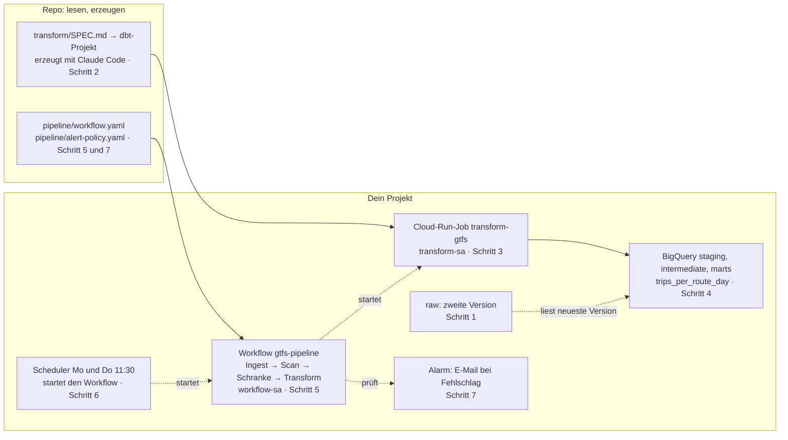

# Lektion 2: Von den Rohdaten zur Antwort, jede Woche

## Worum es geht

Nach Lektion 1 liegen die Rohdaten in deinem Projekt, der Ingest läuft nach Zeitplan, und ein
Scan prüft sie. Heute wird daraus die Antwort auf die Kursfrage: Wie viele Fahrten fährt jede
Linie der Verkehrsbetriebe Luzern pro Tag? Und zwar so, dass die Antwort jeden Montag und
Donnerstag von selbst entsteht, nur aus geprüften Daten, und dass jemand eine E-Mail bekommt,
wenn etwas schiefgeht.

Dafür kommen heute drei Dinge dazu: eine Transformation mit dbt, die du diesmal nicht liest,
sondern aus einer Spezifikation erzeugen lässt. Ein Workflow, der Ingest, Prüfung und
Transformation zu einer Kette verbindet, mit einer Schranke dazwischen. Und ein Alarm.

Wie die Spezifikation zur Transformation in einem Team aussähe, steht in
[SPEC-IM-TEAM.md](SPEC-IM-TEAM.md). Lies das vor oder nach der Lektion, es erklärt, warum
die Prompts hier so aussehen, wie sie aussehen.

## Die Karte



## Bevor es losgeht

Im Terminal, im Ordner `daeng-hs26-gcp`:

```bash
git pull
gcloud auth login
gcloud auth application-default login
claude
```

Das Repo hat neue Ordner (`transform/`, `referenz/`, `pipeline/`) und eine neue
`CLAUDE.md`. Die zwei Logins, weil die Anmeldung von ZHAW-Konten nach einigen Stunden
abläuft. Claude Code neu starten, damit es die neuen Regeln liest.

Die Prompts nennen nie eine Projekt-ID. Claude Code nimmt das Projekt, das in gcloud aktiv
ist. Prüfe vor dem Start, dass es deines ist, vor allem wenn du schon andere Google-Cloud-
Projekte hast:

```bash
gcloud config get-value project
```

Steht dort ein anderes: `gcloud config set project daeng-KÜRZEL-XXXX` und
`gcloud auth application-default set-quota-project daeng-KÜRZEL-XXXX`, dann erst `claude`.

Wie in Lektion 1: Prompt einfügen, jeden Befehl lesen und mit der Liste vergleichen,
freigeben, in der Console nachschauen.

---

## 1. Eine zweite Version

**Warum.** Der Publisher veröffentlicht erst morgen wieder, aber die Transformation soll heute
schon beweisen, dass sie mit mehreren Versionen umgehen kann. Also laden wir die Vorversion
von Hand. Der Ingest-Job bekommt dafür einmalig eine andere Quelle, seine Definition bleibt
unverändert. Das ist derselbe Mechanismus, mit dem man im Betrieb eine alte Version nachlädt.

Prompt:

```text
Starte den Job ingest-gtfs einmal mit einer anderen Quelle, nur für diese eine Execution,
ohne den Job dauerhaft zu ändern:
SOURCE_URL=https://data.opentransportdata.swiss/dataset/3d2c18f9-9ef1-463f-a249-5c67604efd74/resource/dc6c2c40-55ba-4455-8211-239f83b56c8f/download/gtfs_fp2026_20261014.zip
Warte auf das Ende. Zeige mir dann, nur lesend, pro Tabelle die Partitionen mit Zeilenzahl aus
INFORMATION_SCHEMA.PARTITIONS.
```

Befehle:

```bash
gcloud run jobs execute ingest-gtfs --region europe-west6 --wait \
  --update-env-vars SOURCE_URL=https://data.opentransportdata.swiss/dataset/3d2c18f9-9ef1-463f-a249-5c67604efd74/resource/dc6c2c40-55ba-4455-8211-239f83b56c8f/download/gtfs_fp2026_20261014.zip

bq query --use_legacy_sql=false \
  'SELECT table_name, partition_id, total_rows
   FROM raw.INFORMATION_SCHEMA.PARTITIONS
   WHERE partition_id != "__NULL__" ORDER BY 1, 2'
```

Erwartet: jede Tabelle hat jetzt zwei Partitionen, `20261014` und `20261017`. Die Zahlen
unterscheiden sich leicht, drei Tage Fahrplan:

| Tabelle | 20261014 | 20261017 |
|---|---|---|
| stop_times | 42 148 014 | 42 243 848 |
| trips | 2 596 233 | 2 601 990 |
| stops | 104 410 | 104 831 |

Console: [Cloud Storage → Buckets](https://console.cloud.google.com/storage/browser) →
`<projekt-id>-raw` → `raw/gtfs/`: zwei Ordner, `version=20261014` und `version=20261017`,
je neun Dateien. Das ist die Geschichte der Rohdaten, als Ordner sichtbar. In BigQuery zeigt
`raw` → `trips` → Tab **Details** "Anzahl Partitionen: 2", manchmal erst nach ein paar Minuten.
Die Abfrage oben ist die verlässliche Sicht.

Wer diese Lektion an einem anderen Tag macht: Auf https://data.opentransportdata.swiss/dataset/timetable-2026-gtfs2020
steht jede Version mit eigener Download-URL. Irgendeine ältere tut es.

Checkpoint: Zwei Partitionen pro Tabelle, die neuere ist unverändert.

---

## 2. Die Transformation erzeugen

**Warum.** Die Rohdaten beantworten keine Frage. Sie sind acht Tabellen voller Text, so wie der
Publisher sie liefert. Die Transformation macht daraus eine Tabelle, die die Frage
beantwortet. Das ist der Teil der Pipeline, in dem das Fachwissen steckt, und deshalb der Teil,
den du heute nicht liest, sondern aus einer Spezifikation schreiben lässt.

**Wie eine Transformation aufgebaut ist.** Nicht in einem Schritt, sondern in drei Stufen,
und jede Stufe ist eine eigene Tabelle:

1. **Staging** räumt auf. Aus Text werden Zahlen und Daten, und von allem, was der Publisher
   liefert, bleibt nur der Teil, der uns interessiert. Keine Rechnung, keine neue Information,
   nur sauber und klein.
2. **Intermediate** rechnet das aus, was in den Daten nur indirekt steht.
3. **Marts** beantworten die Frage, eine Tabelle pro Frage, so gebaut, dass man sie direkt
   abfragen oder in ein Dashboard hängen kann.

Warum drei statt einer: Jede Stufe lässt sich einzeln anschauen und einzeln testen. Wenn die
Antwort falsch ist, findet man die Stufe, in der es schiefgeht. Und eine zweite Frage morgen
braucht nur einen zweiten Mart, Staging und Intermediate gibt es schon.

**Auf unseren Fall übersetzt.** Die Frage lautet: Wie viele Fahrten fährt jede Linie der
Verkehrsbetriebe Luzern pro Tag? Im Fahrplan steht das nirgends direkt, und das aus einem
Grund, den jeder kennt, der SBB fährt: Der Fahrplan sagt nicht "die Linie 1 fährt am
23. Oktober 212 Mal", er sagt "diese Fahrt verkehrt Montag bis Freitag, ausser an Feiertagen,
und am 1. November zusätzlich". Eine Regel plus Ausnahmen, pro Fahrt. So bleibt der Fahrplan
klein. Für unsere Frage muss man die Regel in Tage auflösen.

- Staging: aus dem ganzen Schweizer Fahrplan nur die Verkehrsbetriebe Luzern, aus `"20261017"`
  wird ein Datum, aus `"1"` wird ja.
- Intermediate: aus "Montag bis Freitag, 14. Dezember bis 12. Dezember, ausser am 1. August" wird
  eine Liste von Tagen, an denen die Fahrt tatsächlich fährt. Für die nächsten zwei Wochen.
- Mart: zählen, wie viele Fahrten pro Linie und Tag übrig bleiben.

**Was dbt dazu tut.** dbt ist das Werkzeug, das diese Tabellen in der richtigen Reihenfolge in
BigQuery baut. Jede Tabelle ist eine SQL-Datei. Eine Datei verweist mit `ref()` auf die
Tabelle, von der sie liest, und aus diesen Verweisen weiss dbt, was zuerst kommt. Danach
laufen Tests: Ist der Schlüssel eindeutig, ist die Spalte nie leer, stimmt die Anzahl Tage im
Fenster. Schlägt ein Test fehl, hört dbt auf.

**Zwei Entscheidungen, die Data Engineering sind.** Der Mart liest immer genau eine Version,
die neueste. Ein Mart über zwei Versionen würde jede Fahrt doppelt zählen, denn dieselbe Fahrt
am selben Tag steht in beiden. Und der Mart wird bei jedem Lauf ganz ersetzt, weil die Frage
"was sagt der aktuelle Fahrplan" lautet. Wer wissen will, wie sich die Antwort von Version zu
Version verändert, baut daraus eine zweite Tabelle, die nichts wegwirft. Das ist ein anderes
Tutorial.

**Was jetzt passiert.** `transform/SPEC.md` beschreibt die drei Stufen, die Tabellen, ihre
Spalten und die Tests. Claude Code macht daraus das dbt-Projekt. Die Musterlösung liegt in
`referenz/transform/`, und Claude Code schaut sie nicht an, das steht in `CLAUDE.md`. Am Ende
vergleichst du nicht den Code, sondern die Zahlen.

Prompt:

```text
Lies transform/SPEC.md und setze sie vollständig in transform/ um. Schau den Ordner
referenz/ nicht an. Prüfe vorher mit einer Abfrage (dry run zuerst), welche agency_name in
raw.agency auf "luzern" passen. Zeige mir am Ende die Liste der Dateien und die Modelle
stg_agency, int_service_dates und trips_per_route_day, und warte auf mein OK.
```

Das dauert einige Minuten. Zuerst das Einfachste: Vergleiche die Dateiliste mit dem
Checkpoint unten, das ist die zweite Frage des Reviews aus [SPEC-IM-TEAM.md](SPEC-IM-TEAM.md),
was wurde weggelassen. Fehlt eine Datei, sag es, bevor du OK gibst. Dann liest du, ohne
SQL-Kenntnisse: Steht in `stg_agency` ein Filter auf Luzern? Kommen in `int_service_dates` die Wörter für Regel und
Ausnahmen vor (`calendar`, `calendar_dates`, `exception_type`), und wird erst hinzugefügt
(Typ 1), dann weggenommen (Typ 2)? Zählt `trips_per_route_day` mit `COUNT` und gruppiert nach
Tag und Linie?

Wer vergleichen will: `diff -r referenz/transform transform` zeigt, wo deine Fassung von der
Musterlösung abweicht. Zwei Agenten, zwei Fassungen, derselbe Mart. Das ist normal.

Nach deinem OK schlägt Claude Code wahrscheinlich von sich aus vor, wie es weitergeht: dbt
lokal laufen lassen, einen Job anlegen, einen Service-Account dazu. Sag nicht ja. Gib ihm
den ersten Prompt aus Schritt 3. Der Vorschlag klingt vernünftig, aber er erfindet Namen, zum
Beispiel `transform-dbt` statt `transform-gtfs`, und der Workflow in Schritt 5 ruft den Job
unter dem Namen aus der Spezifikation auf. Namen sind Schnittstellen, deshalb stehen sie im
Prompt und nicht im Ermessen des Agenten.

Console: noch nichts. Schritt 2 erzeugt nur Dateien in deinem Repo. In der Cloud entsteht
erst in Schritt 3 etwas.

Claude Code bietet irgendwann an, `transform/` zu committen. Nicht nötig: Das Repo gehört dem
Kurs, pushen kannst du nicht, und deine Fassung bleibt in deinem Klon. Wer sie behalten will,
committet lokal, das schadet nicht.

Checkpoint: `transform/` enthält `dbt_project.yml`, `profiles.yml`, `Dockerfile`,
`macros/`, `models/` mit drei Unterordnern, `tests/`.

---

## 3. Als Job deployen

**Warum.** Dasselbe Muster wie in Lektion 1: eine Identität mit genau den nötigen Rechten,
ein Container aus dem Quellcode, ein Job. Neu ist nur eine Umgebungsvariable, weil dbt die
Projekt-ID braucht und sie nicht in der Datei stehen soll.

Prompt 1:

```text
Lege einen Service-Account transform-sa an. Er bekommt genau zwei Rechte auf dem Projekt:
BigQuery Data Editor, weil er Datasets anlegen und Tabellen schreiben muss, und BigQuery Job
User. Warte nach dem Anlegen, bis describe ihn zeigt. Zeige mir danach, nur lesend, seine
Rechte.
```

Prompt 2:

```text
Deploye transform/ als Cloud-Run-Job transform-gtfs in europe-west6, gebaut aus dem
Quellcode mit dem Dockerfile, Service-Account transform-sa, 1 GiB Speicher, 1 CPU,
20 Minuten Timeout, ohne Wiederholung, mit der Umgebungsvariable DBT_PROJECT auf meine
Projekt-ID. Starte den Job danach und warte auf das Ende. Zeige mir die letzten 40 Zeilen
des Logs.
```

Befehle:

```bash
gcloud iam service-accounts create transform-sa --display-name="Transform-Job dbt"

gcloud projects add-iam-policy-binding daeng-KÜRZEL-XXXX \
  --member="serviceAccount:transform-sa@daeng-KÜRZEL-XXXX.iam.gserviceaccount.com" \
  --role="roles/bigquery.dataEditor"

gcloud projects add-iam-policy-binding daeng-KÜRZEL-XXXX \
  --member="serviceAccount:transform-sa@daeng-KÜRZEL-XXXX.iam.gserviceaccount.com" \
  --role="roles/bigquery.jobUser"

gcloud run jobs deploy transform-gtfs --source transform --region europe-west6 \
  --service-account=transform-sa@daeng-KÜRZEL-XXXX.iam.gserviceaccount.com \
  --memory=1Gi --cpu=1 --task-timeout=20m --max-retries=0 \
  --set-env-vars DBT_PROJECT=daeng-KÜRZEL-XXXX

gcloud run jobs execute transform-gtfs --region europe-west6 --wait
```

Beim Deploy kann der Auto-Modus an seine Grenze kommen: Claude Code sagt, der Befehl sei
gesperrt, und zeigt ihn dir mit `!` am Anfang. Das ist kein Fehler, sondern das zweite Modell,
das einen Deploy nicht selbst freigibt. Lies den Befehl, vergleiche ihn mit dem oben (Name
`transform-gtfs`, Service-Account `transform-sa`, `DBT_PROJECT` ist dein Projekt), und führ
ihn mit der `!`-Zeile selbst aus. Claude Code sieht das Ergebnis und macht mit dem
`execute` weiter.

Im Log siehst du die gewählte Version, dann jedes Modell und jeden Test mit `OK`, und am Ende
die Zusammenfassung von dbt: `Done. PASS=22 ... TOTAL=22`. Die Zahl kann bei dir leicht
abweichen, je nachdem, wie viele Tests deine Fassung hat.

Console, in dieser Reihenfolge: [IAM](https://console.cloud.google.com/iam-admin/iam) zeigt
`transform-sa` mit zwei Rollen. Während des Builds
[Cloud Build → Verlauf](https://console.cloud.google.com/cloud-build/builds) den laufenden
Build, danach [Cloud Run → Jobs](https://console.cloud.google.com/run/jobs) den Job
`transform-gtfs`, seine Execution und unter Logs die dbt-Ausgabe, Modell für Modell. Und in
[BigQuery](https://console.cloud.google.com/bigquery) drei neue Datasets, `staging`,
`intermediate`, `marts`, die der Job angelegt hat.

**Was entstanden ist.** Die drei Datasets sind die drei Stufen aus Schritt 2, je eine Tabelle
als Beispiel:

- `staging.stg_trips`: eine Auswahl der Spalten von `raw.trips`, aber nur die neueste Version,
  nur Fahrten der Verkehrsbetriebe Luzern, `direction_id` als Zahl statt Text. Filtern und
  Typen richten, mehr tut Staging nicht. Daneben `stg_agency` mit einer einzigen Zeile: Das ist
  der Filter, über den alle anderen Staging-Tabellen klein werden.
- `intermediate.int_service_dates`: eine Zeile pro Dienst und Tag, an dem er fährt, für die 14
  Tage ab Versionsdatum. Diese Tabelle gibt es im Feed nicht, sie ist aus Regel und Ausnahmen
  ausgerechnet.
- `marts.trips_per_route_day`: eine Zeile pro Linie und Tag mit `n_trips`. Das ist die Antwort
  und die einzige Tabelle, die jemand ausserhalb der Pipeline abfragt.

In BigQuery das Dataset aufklappen und eine Tabelle anklicken: "Schema" zeigt die Spalten,
"Details" die Zeilenzahl, "Vorschau" die ersten Zeilen, ohne dass eine Abfrage läuft. Jede
Tabelle trägt `feed_version`, in allen drei Stufen dieselbe. Die Spalten deiner Staging-
Tabellen können von der Musterlösung abweichen, der Mart nicht, seine Spalten stehen in der
Spezifikation.

Wenn dein Projekt nicht baut oder dbt mit einem Fehler endet, den du nicht in zwei Minuten
verstehst: Musterlösung hinein und nochmals deployen. Das ist der Grund, warum sie da ist.

```bash
cp -r referenz/transform/. transform/
```

Checkpoint: Execution grün, dbt-Zusammenfassung ohne `ERROR` und ohne `FAIL`.

---

## 4. Die Antwort prüfen

**Warum.** Drei Datasets sind entstanden, und der Mart ist die Antwort auf die Kursfrage.
Ob deine Fassung richtig rechnet, sagt der Vergleich mit der Musterlösung: nicht der Code,
die Summe.

Prompt:

```text
Nur lesend: die Datasets im Projekt, die Tabellen in staging, intermediate und marts mit
Zeilenzahl, dann auf marts.trips_per_route_day (dry run zuerst): (a) Anzahl Zeilen, Anzahl
Linien, kleinstes und grösstes service_date, Summe n_trips, feed_version, (b) Summe n_trips
pro Wochentag, sortiert Montag bis Sonntag.
```

Befehle:

```bash
bq ls

bq query --use_legacy_sql=false \
  'SELECT COUNT(*) AS zeilen, COUNT(DISTINCT route_id) AS linien,
          MIN(service_date) AS von, MAX(service_date) AS bis,
          SUM(n_trips) AS fahrten, ANY_VALUE(feed_version) AS feed_version
   FROM marts.trips_per_route_day'

bq query --use_legacy_sql=false \
  'SELECT weekday, SUM(n_trips) AS fahrten
   FROM (
     SELECT weekday, n_trips,
            MOD(EXTRACT(DAYOFWEEK FROM service_date) + 5, 7) AS tag_nr
     FROM marts.trips_per_route_day
   )
   GROUP BY weekday, tag_nr
   ORDER BY tag_nr'
```

Die zweite Abfrage braucht die Unterabfrage, weil BigQuery nicht nach einer Spalte sortieren
kann, die nicht in der Gruppierung steht. Claude Code läuft beim ersten Versuch oft in
diesen Fehler und korrigiert ihn selbst, das ist in Ordnung.

Erwartet, mit Version 20261017 und dem Fenster 17. bis 30. Oktober:

| | Musterlösung |
|---|---|
| Zeilen | 370 |
| Fahrten | 60 554 |
| Fenster | 2026-10-17 bis 2026-10-30 |
| feed_version | 2026-10-17 |

| Wochentag | Fahrten an zwei Tagen |
|---|---|
| Montag bis Donnerstag | je 9 114 |
| Freitag | 9 238 |
| Samstag | 8 039 |
| Sonntag | 6 821 |

Stimmen deine Zahlen, rechnet deine Fassung richtig. Stimmen sie nicht, obwohl alle Tests
grün sind, dann liegt die Abweichung fast sicher in `int_service_dates`, in der Reihenfolge
von Regel und Ausnahmen, und `diff` zeigt sie dir. Tests prüfen Form, nicht Wahrheit.

Console: [BigQuery](https://console.cloud.google.com/bigquery) → `marts` →
`trips_per_route_day` → Tab **Lineage**. Der Graph hat jetzt drei Stufen: `raw` links,
`staging` und `intermediate` in der Mitte, der Mart rechts. Jede Kante ist ein dbt-Modell.

Die Version im Mart ist `2026-10-17`, obwohl du zuletzt `20261014` geladen hast. Das Makro
in `macros/latest_version.sql` wählt die neueste Version, nicht die zuletzt geladene.

Checkpoint: 370 Zeilen, 60 554 Fahrten.

---

## 5. Die Kette

**Warum.** Bis jetzt startet der Scheduler den Ingest, und alles andere startet jemand von
Hand. Ein Workflow verbindet die drei Teile: erst der Ingest, dann der Scan, und erst wenn
der Scan bestanden ist, die Transformation. Schlägt ein Teil fehl, stoppt die Kette dort.
Der Mart behält dann die letzte gute Version, statt mit fehlerhaften Daten überschrieben zu
werden. Das ist die Qualitätsschranke, und sie ist der Grund, warum der Scan aus Lektion 1
überhaupt da ist.

`pipeline/workflow.yaml` ist fertig im Repo, du liest sie. Projekt und Region holt sie zur
Laufzeit aus der Umgebung, deshalb ist die Datei in jedem Projekt dieselbe.

**Zwei Arten von Identitäten.** Der Workflow bekommt wie die Jobs einen eigenen
Service-Account, `workflow-sa`. Daneben gibt es den Service Agent von Workflows, ein Konto,
das Google selbst verwaltet und mit dem der Dienst in deinem Projekt arbeitet. Google legt
ihn nach dem Einschalten der API an, aber mit Verzögerung. Wir legen ihn deshalb ausdrücklich
an, sonst scheitert der Deploy.

**Rechte, und warum so viele.** `workflow-sa` braucht vier Dinge, und jedes hat einen Grund:
die Jobs starten (Invoker, auf den beiden Jobs). Zuschauen, bis sie fertig sind (Cloud Run
Viewer, auf dem Projekt, weil das Warten über eine Operation läuft, die am Projekt hängt,
nicht am Job). Den Scan starten und sein Ergebnis lesen (eine Dataplex-Rolle auf dem Scan,
dort gibt es kein `add-iam-policy-binding`, nur Policy lesen, ergänzen, zurückschreiben).
Logs schreiben (auf dem Projekt). Least Privilege reicht bei jedem Dienst anders weit, und
die ehrliche Version ist, zu wissen, wo.

Prompt 1:

```text
Lies pipeline/workflow.yaml und erkläre mir die Schritte in je einem Satz. Erkläre
besonders, was in check_gate passiert und was der Workflow zurückgibt. Ändere nichts.
```

Prompt 2:

```text
Aktiviere die APIs workflows und workflowexecutions. Lege dann den Service Agent für
Workflows an (gcloud beta services identity create). Lege einen Service-Account workflow-sa
an und warte, bis describe ihn zeigt. Rechte: Cloud Run Invoker auf den Jobs ingest-gtfs und
transform-gtfs, Cloud Run Viewer auf dem Projekt, Dataplex DataScan Editor auf dem Scan
trips-quality (per get-iam-policy, Datei ergänzen, set-iam-policy mit etag), Logs Writer auf
dem Projekt. Deploye dann pipeline/workflow.yaml als Workflow gtfs-pipeline in europe-west6
mit workflow-sa und call-log-level log-all-calls. Starte ihn einmal und warte auf das Ende,
das dauert etwa sechs Minuten. Zeige mir das Ergebnis.
```

Befehle:

```bash
gcloud services enable workflows.googleapis.com workflowexecutions.googleapis.com

gcloud beta services identity create --service=workflows.googleapis.com

gcloud iam service-accounts create workflow-sa --display-name="Workflow gtfs-pipeline"

gcloud run jobs add-iam-policy-binding ingest-gtfs --region=europe-west6 \
  --member="serviceAccount:workflow-sa@daeng-KÜRZEL-XXXX.iam.gserviceaccount.com" \
  --role="roles/run.invoker"

gcloud run jobs add-iam-policy-binding transform-gtfs --region=europe-west6 \
  --member="serviceAccount:workflow-sa@daeng-KÜRZEL-XXXX.iam.gserviceaccount.com" \
  --role="roles/run.invoker"

gcloud projects add-iam-policy-binding daeng-KÜRZEL-XXXX \
  --member="serviceAccount:workflow-sa@daeng-KÜRZEL-XXXX.iam.gserviceaccount.com" \
  --role="roles/run.viewer"

gcloud dataplex datascans get-iam-policy trips-quality --location=europe-west6 \
  --format=json > /tmp/scan-policy.json
# Datei: workflow-sa mit roles/dataplex.dataScanEditor ergänzen, etag behalten
gcloud dataplex datascans set-iam-policy trips-quality /tmp/scan-policy.json \
  --location=europe-west6

gcloud projects add-iam-policy-binding daeng-KÜRZEL-XXXX \
  --member="serviceAccount:workflow-sa@daeng-KÜRZEL-XXXX.iam.gserviceaccount.com" \
  --role="roles/logging.logWriter"

gcloud workflows deploy gtfs-pipeline --source=pipeline/workflow.yaml \
  --location=europe-west6 \
  --service-account=workflow-sa@daeng-KÜRZEL-XXXX.iam.gserviceaccount.com \
  --call-log-level=log-all-calls

gcloud workflows run gtfs-pipeline --location=europe-west6
```

Während der sechs Minuten: [Workflows](https://console.cloud.google.com/workflows) →
`gtfs-pipeline`. Der Tab Quelle zeigt neben dem YAML ein Diagramm der Schritte, mit der
Schleife in `wait_for_scan` und der Verzweigung in `check_gate`. Unter Executions die
laufende Execution öffnen: Du siehst die Schritte, wie sie nacheinander drankommen, mit Dauer,
und unter Logs jeden Aufruf. In der Musterlösung: Ingest 179
Sekunden, Scan 153 Sekunden mit elf Abfragen im Abstand von 15 Sekunden, Transform 45
Sekunden, zusammen 6 Minuten 17 Sekunden.

Das Ergebnis ist ein kleines Dict: die Ingest-Execution, der Scan-Job, `passed: true`, die
Transform-Execution. Unter [Cloud Run → Jobs](https://console.cloud.google.com/run/jobs)
steht bei beiden Executions "Ausgeführt von: workflow-sa".

Checkpoint: Execution SUCCEEDED, `passed: true`, Mart unverändert (dieselbe Version wie in
Schritt 4).

---

## 6. Der Zeitplan rückt eine Stufe hoch

**Warum.** Der Scheduler aus Lektion 1 startet den Ingest-Job. Ab jetzt startet er den
Workflow, und der Workflow startet die Jobs. Der alte Zeitplan muss weg, sonst läuft der
Ingest zweimal. Das Löschen machst du selbst: gcloud fragt vor dem Löschen nach, Claude Code
kann diese Frage nicht beantworten und darf sie laut `CLAUDE.md` auch nicht umgehen. Das ist
Absicht. Löschen ist der eine Befehl, bei dem ein Mensch Y tippt.

Prompt:

```text
scheduler-sa bekommt die Rolle Workflows Invoker auf dem Projekt, auf einem einzelnen
Workflow lässt sie sich nicht vergeben. Lege einen Scheduler-Job gtfs-pipeline-schedule in
europe-west6 an, Montag und Donnerstag 11:30 Europe/Zurich, der über die
Workflow-Executions-API eine Execution von gtfs-pipeline startet, OAuth mit scheduler-sa.
Zeige mir danach beide Scheduler-Jobs. Den alten lösche ich selbst.
```

Befehle:

```bash
gcloud projects add-iam-policy-binding daeng-KÜRZEL-XXXX \
  --member="serviceAccount:scheduler-sa@daeng-KÜRZEL-XXXX.iam.gserviceaccount.com" \
  --role="roles/workflows.invoker"

gcloud scheduler jobs create http gtfs-pipeline-schedule --location=europe-west6 \
  --schedule="30 11 * * 1,4" --time-zone="Europe/Zurich" \
  --uri="https://workflowexecutions.googleapis.com/v1/projects/daeng-KÜRZEL-XXXX/locations/europe-west6/workflows/gtfs-pipeline/executions" \
  --http-method=POST \
  --oauth-service-account-email="scheduler-sa@daeng-KÜRZEL-XXXX.iam.gserviceaccount.com"
```

Dann du, in einem eigenen Terminalfenster, nicht in Claude Code:

```bash
gcloud scheduler jobs delete ingest-gtfs-schedule --location=europe-west6
```

gcloud fragt `Do you want to continue (Y/n)?`, du tippst `Y`.

Console: [Cloud Scheduler](https://console.cloud.google.com/cloudscheduler) zeigt genau
einen Job, `gtfs-pipeline-schedule`, nächste Ausführung Donnerstag 11:30.

Checkpoint: Ein Scheduler-Job, Ziel ist der Workflow.

---

## 7. Der Alarm

**Warum.** Eine Pipeline, die still scheitert, ist schlimmer als keine: Der Mart zeigt dann
wochenlang alte Zahlen, und niemand merkt es. `pipeline/alert-policy.yaml` beschreibt eine
Alarmrichtlinie mit zwei Bedingungen: ein Cloud-Run-Job ist fehlgeschlagen, oder der Workflow
ist fehlgeschlagen. Beides sind Metriken, die Google von selbst zählt, kein Suchen in
Logtexten. Die Richtlinie braucht einen Kanal, hier deine E-Mail-Adresse. Und sie wird
geprüft, indem wir einen Fehlschlag auslösen: der Ingest-Job mit einer Adresse, die es nicht
gibt.

Prompt 1:

```text
Lege einen E-Mail-Benachrichtigungskanal für Monitoring an, Adresse ist die meines aktiven
gcloud-Kontos. Setze seine ID in einer Kopie von pipeline/alert-policy.yaml für CHANNEL_ID
ein, nicht in der Datei im Repo, und lege die Richtlinie daraus an. Zeige mir die Richtlinie.
```

Prompt 2:

```text
Starte ingest-gtfs einmal mit SOURCE_URL=https://example.invalid/gtfs.zip, nur für diese
Execution, und warte. Erwartung: Die Execution scheitert innert Sekunden. Zeige mir die
letzte Zeile des Logs.
```

Befehle:

```bash
gcloud beta monitoring channels create --display-name="E-Mail Kurs" \
  --type=email --channel-labels=email_address=KÜRZEL@zhaw.ch

gcloud alpha monitoring policies create --policy-from-file=/tmp/alert-policy.yaml

gcloud run jobs execute ingest-gtfs --region europe-west6 --wait \
  --update-env-vars SOURCE_URL=https://example.invalid/gtfs.zip
```

Die Execution endet nach etwa 15 Sekunden mit `Failed to resolve 'example.invalid'`. Etwa
fünf Minuten später: [Monitoring → Alerting](https://console.cloud.google.com/monitoring/alerting)
zeigt einen Vorfall "gtfs-pipeline fehlgeschlagen", Bedingung "Cloud-Run-Job
fehlgeschlagen", `job_name: ingest-gtfs`. Und eine E-Mail mit denselben Angaben und den zwei
Sätzen aus der Richtlinie, was zu tun ist.

Ein paar Minuten danach ist der Vorfall in der Console geschlossen, obwohl du nichts
repariert hast, und die Tabelle unter Alerting ist wieder leer ("Show closed alerts" oben
rechts zeigt ihn weiterhin). Das klingt falsch und ist konsequent: Monitoring weiss nicht,
ob die Pipeline in Ordnung ist. Es weiss nur, ob die Bedingung der Richtlinie gerade
zutrifft, und die lautet "mehr als null fehlgeschlagene Executions in den letzten fünf
Minuten". Der Fehlschlag war ein Ereignis um 18:12, kein Zustand. Fünf Minuten später zählt
das Fenster wieder null, die Bedingung trifft nicht mehr zu, und der Vorfall geht zu.
Geschlossen heisst hier: Bedingung nicht mehr erfüllt, nicht Problem gelöst. Anders wäre es
bei einem Zustand wie "Festplatte voll", da bleibt die Metrik über dem Schwellwert, bis
jemand handelt, und der Vorfall bleibt offen. Für einen fehlgeschlagenen Job gibt es keinen
Zustand, den die Metrik beobachten könnte, und ein längeres Fenster würde nur die E-Mail
verzögern und den Vorfall länger offen halten.

Monitoring ist deshalb der Rauchmelder, nicht das Ticket. Standardmässig schickt es beim
Schliessen eine zweite E-Mail, "Alert recovered", und die wäre eine Lüge, denn behoben ist
nichts. Die Richtlinie stellt das ab: `notificationPrompts: [OPENED]`, eine E-Mail pro
Vorfall, beim Öffnen. Ob es behoben ist, entscheidet, wer die E-Mail bekommt. Im Team landet
sie über einen Webhook-Kanal in einem Ticket- oder Bereitschaftswerkzeug, und dort schliesst
ein Mensch das Ticket, unabhängig davon, was Monitoring über die Metrik sagt. Ein Alarm, der
in Monitoring selbst offen bleibt, bis es wieder läuft, bräuchte eine Bedingung, die ein
Zustand ist: "keine erfolgreiche Execution seit fünf Tagen". Das ist nicht Teil dieser
Lektion.

Checkpoint: Die E-Mail ist da.

---

## 8. Was jetzt läuft

In deinem Projekt läuft ab jetzt ohne dich: Montag und Donnerstag um 11:30 startet der
Scheduler den Workflow. Der holt den neuen Fahrplan, legt ihn ab, lädt ihn, prüft ihn, und
baut die Antwort neu, wenn die Prüfung besteht. Scheitert etwas, bekommst du eine E-Mail.
Der erste Lauf, bei dem niemand zuschaut, ist morgen. Schau am Freitag nach:
[Workflows](https://console.cloud.google.com/workflows) → `gtfs-pipeline` → Executions,
und der Mart sollte die Version von morgen tragen.

Was es kostet: [Abrechnung → Berichte](https://console.cloud.google.com/billing/reports),
gefiltert auf dein Projekt. Zwei Läufe pro Woche, je unter einem Rappen für Cloud Run und
BigQuery, die Rohdaten im Bucket und in BigQuery ein paar Rappen im Monat, Partitionen
verfallen nach 90 Tagen. Das Guthaben reicht bis weit über das Semester hinaus. Lass alles
laufen, es gehört zum nächsten Tutorial.

Was in der Industrie an denselben Stellen steht:

| Hier | Dort |
|---|---|
| dbt als Cloud-Run-Job | dbt Cloud, Dataform (das GCP-eigene Pendant) |
| Cloud Workflows mit Schranke | Airflow (Cloud Composer), Dagster, Prefect |
| Dataplex-Scan als Schranke | Great Expectations, Soda, Monte Carlo |
| Alarm auf zwei Metriken | PagerDuty, Opsgenie, ein Dashboard dazu |
| Mart ersetzt pro Lauf | Snapshots, langsam veränderliche Dimensionen |
| Rollen von Hand vergeben | Terraform, eine Rolle pro Zweck als Code |
| Spezifikation als Prompt | Issue, Pull Request, Review, CI ([SPEC-IM-TEAM.md](SPEC-IM-TEAM.md)) |

Die Ideen sind dieselben. Was sich ändert, ist, wie viele Leute dasselbe Ding gleichzeitig
anfassen.

Nächstes Tutorial: Das Fenster im Mart ist eine Variable, `window_days`. Auf 365 gesetzt
liefert eine einzige Version 50 Linien mal ein Jahr. Daraus trainiert BigQuery ML mit einem
SQL-Befehl ein Modell, das Fahrten pro Linie und Tag vorhersagt.

---

## Wenn etwas schiefgeht

- **dbt endet mit einem Fehler in deiner erzeugten Fassung:** `cp -r referenz/transform/. transform/`,
  Job nochmals deployen (Schritt 3, Prompt 2). Danach kannst du mit `diff` nachsehen, was
  anders war.
- **Deine Zahlen in Schritt 4 weichen von der Musterlösung ab, Tests sind grün:** Fast immer
  `int_service_dates`. Prüfe die Reihenfolge: erst Regel plus Ausnahmen Typ 1, dann
  Ausnahmen Typ 2 abziehen. Und das Fenster: 14 Tage ab dem Versionsdatum, einschliesslich.
- **Deploy des Workflows: "Workflows service agent does not exist":** Die API ist gerade
  erst eingeschaltet, Google hat den Service Agent noch nicht angelegt.
  `gcloud beta services identity create --service=workflows.googleapis.com`, dann Deploy
  wiederholen.
- **Workflow scheitert sofort in run_ingest mit "IAM permission denied for service account
  workflow-sa" (AuthError):** Der Service Agent von Workflows holt für `workflow-sa` ein
  Token, und das scheitert, bevor Cloud Run überhaupt gefragt wird. Die Rechte sind richtig,
  aber Service Agent, Account und Rollen sind wenige Minuten alt, und IAM braucht bis zu
  sieben Minuten, bis neue Rollen überall gelten. Ein paar Minuten warten, dann
  `gcloud workflows run gtfs-pipeline --location=europe-west6` nochmals. Nichts ändern.
- **Workflow scheitert in run_ingest mit "Permission 'run.operations.get' denied":**
  `workflow-sa` fehlt Cloud Run Viewer auf dem Projekt. Der Ingest-Job läuft trotzdem zu
  Ende, warte das ab, dann Rolle vergeben und Workflow nochmals starten.
- **"Invalid choice: 'add-iam-policy-binding'" bei Dataplex oder Workflows:** Diese Dienste
  haben den Befehl nicht. Dataplex: Policy lesen, ergänzen, mit `set-iam-policy`
  zurückschreiben. Workflows: Rolle auf dem Projekt vergeben.
- **"This prompt could not be answered because you are not in an interactive session" beim
  Löschen:** Erwartet. Den Lösch-Befehl selbst im Terminal ausführen und `Y` tippen.
- **gcloud kennt einen Befehl nicht, den du erwartest (Metrik-Beschreibungen, Regionen von
  Workflows):** gcloud deckt nicht jede API ab. Claude Code schlägt dir dann die API direkt
  vor, mit `gcloud auth print-access-token` als kurzlebigem Schlüssel. Das ist normale
  Praxis, kein Umweg.
- **Keine E-Mail nach zehn Minuten:** Monitoring → Alerting → Vorfälle. Steht der Vorfall
  dort, ist der Kanal falsch (Adresse prüfen). Steht er nicht dort, hat die Richtlinie die
  Metrik nicht gesehen, Policy in der Console öffnen und die Bedingung prüfen.
- **Claude Code sagt, ein Befehl sei gesperrt, und nennt den Auto-Modus:** Das ist die
  Grenze des Auto-Modus, kein Fehler. Lies den Befehl, vergleiche ihn mit der Liste, und führ
  ihn mit der `!`-Zeile aus, die Claude Code anbietet. Alternative: `/permissions`, Reiter
  "Recently denied", `r` gibt den Befehl von Hand frei. Sperrt der Auto-Modus dreimal
  hintereinander, pausiert er und Claude Code fragt dich wieder vor jedem Befehl.
- **Claude Code will etwas ausführen, das nicht in der Liste steht:** Nicht freigeben. Frag
  im Chat, warum.
