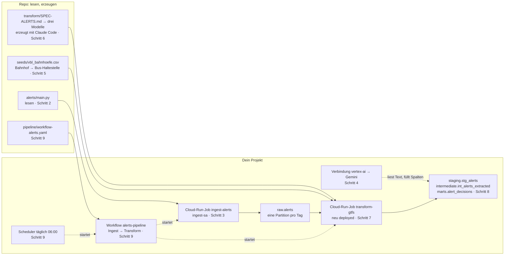

# Lektion 3: Ein Sprachmodell als Funktion in der Pipeline

## Worum es geht

Nach Lektion 2 läuft die Pipeline: Fahrplan rein, prüfen, transformieren, Antwort raus, zweimal
pro Woche, mit Alarm. Die Antwort sagt, wie viele Fahrten jede Linie der Verkehrsbetriebe
Luzern fahren soll. Sie sagt nichts darüber, was in Luzern gerade los ist. Wenn die Bahnlinie
nach Olten unterbrochen ist, stehen am Bahnhof Luzern Leute, die auf einen Bus hoffen, und
der Fahrplan weiss davon nichts.

Das steht in Text. Die SBB veröffentlichen ihre Bahnverkehrsinformationen als offene Daten:
"Interrupted train service on the Luzern - Arth-Goldau line between Meggen and Immensee. This
is due to exceptional construction work. The restriction lasts until approx. 06:00." Ein
Mensch liest das und weiss sofort: Meggen, bis sechs Uhr, Bus. Eine Datenbank liest das nicht.

Heute kommt ein Sprachmodell in die Pipeline, und zwar an genau einer Stelle: Es liest den
Text und macht daraus Spalten. Ursache, Auswirkung, Abschnitt, Beginn, Ende. Was mit den
Spalten passiert, entscheidet danach eine Regel, so wie bisher, mit Schwellen, die ein Mensch
begründen kann. Das Modell liest, die Regel entscheidet. Dieser Satz ist die ganze Lektion.

Dafür kommen heute vier Dinge dazu: eine zweite Quelle mit einem zweiten Ingest-Job. Eine
Verbindung von BigQuery zu Gemini, damit das Modell aus SQL heraus aufgerufen werden kann. Drei
dbt-Modelle, die du wieder aus einer Spezifikation erzeugen lässt. Und eine zweite Kette, die
jeden Tag läuft.

Nichts aus Lektion 1 und 2 wird geändert. Alles Neue kommt dazu, in neuen Dateien und neuen
Tabellen, und hängt sich an das, was schon da ist.

## Die Karte



## Bevor es losgeht

Voraussetzung ist Lektion 2: `transform/` enthält dein dbt-Projekt, der Job `transform-gtfs`
läuft, `marts.trips_per_route_day` existiert, und `workflow-sa`, `scheduler-sa` und der Alarm
sind da. Welche Fahrplan-Version in `raw` liegt, spielt heute keine Rolle, es ist die neueste.

Im Terminal, im Ordner `daeng-hs26-gcp`:

```bash
git pull
gcloud auth login
gcloud auth application-default login
claude
```

Das Repo hat neue Dateien (`alerts/`, `transform/SPEC-ALERTS.md`, `referenz/transform-alerts/`,
`pipeline/workflow-alerts.yaml`) und zwei neue Zeilen in `CLAUDE.md`. Dein eigenes
`transform/` bleibt vom `git pull` unberührt, die neuen Dateien heissen anders als deine.
Claude Code neu starten, damit es die neuen Regeln liest.

Wie in Lektion 2 nennen die Prompts nie eine Projekt-ID. Prüfe, dass dein Projekt aktiv ist:

```bash
gcloud config get-value project
```

Wie bisher: Prompt einfügen, jeden Befehl lesen und mit der Liste vergleichen, freigeben, in
der Console nachschauen.

---

## 1. Die zweite Quelle

**Warum.** Der Fahrplan sagt, was fahren soll. Die Bahnverkehrsinformationen sagen, was
gerade nicht fährt. Die SBB veröffentlichen sie auf data.sbb.ch als offene Daten, rund 500
Meldungen pro Monat, alle fünf Minuten aktualisiert, ohne Schlüssel. Es ist dieselbe Quelle,
aus der die Störungsmeldungen in der SBB-App kommen, nur als Tabelle.

Bevor ein Job sie lädt, schaust du eine Meldung an. Drei Dinge wirst du sehen, die später
Arbeit machen: Der Text ist englisch. Die Zeiten tragen `+00:00`, sind aber Schweizer
Lokalzeit. Und `published` sieht aus wie ein Zeitstempel, ist beim Publisher aber ein
Textfeld, weshalb man nicht "alles seit gestern" abfragen kann, sondern "alles von diesem
Tag".

Prompt:

```text
Hole mit curl eine Meldung aus dem Dataset rail-traffic-information auf data.sbb.ch: der
Export-Endpunkt der Explore-API v2.1 als jsonl, mit dem Filter
where=startswith(published,'2026-10-27'), und zeige mir die erste Zeile formatiert. Erkläre
mir die Felder in je einem halben Satz. Schau dir dann startdatetime, published und die
erste Zeit im Text an und sag mir, was dir auffällt.
```

Befehl:

```bash
curl -sS -G "https://data.sbb.ch/api/explore/v2.1/catalog/datasets/rail-traffic-information/exports/jsonl" \
  --data-urlencode "where=startswith(published,'2026-10-27')" | head -n 1
```

Du siehst eine Zeile JSON mit zwölf Feldern: `title`, `link`, `description`, `published`,
`cause` (immer null), `startdatetime`, `enddatetime`, `dailyvaliditybegin`,
`dailyvalidityend`, `type` (2 ist eine Störung, 5 die Entwarnung), `author` (immer SBB),
`description_html`. Was Claude Code auffallen sollte: `startdatetime` endet auf `+00:00`,
steht aber auf derselben Zeit wie die Lokalzeit am Anfang des Textes. `published` ist
echtes UTC und liegt darum im Winter eine, im Sommer zwei Stunden vor der Lokalzeit im
Text. Beides stimmt, nur die Zeitzone am einen Feld ist falsch. Solche Dinge merkt man
sich, bevor man den Job schreibt, nicht danach.

Console: noch nichts.

Checkpoint: eine JSON-Zeile mit zwölf Feldern, `author` ist `SBB`.

---

## 2. Den Job lesen

**Warum.** Der zweite Ingest-Job ist fertig geschrieben, wie der erste in Lektion 1. Du liest
ihn, weil er sich an drei Stellen vom ersten unterscheidet, und die drei Stellen sind der
Unterschied zwischen einer Quelle, die alle paar Tage eine Version liefert, und einer, die
laufend Meldungen liefert.

Prompt:

```text
Lies alerts/main.py und alerts/SPEC.md. Erkläre mir die vier Schritte in je einem Satz.
Dann vergleiche mit ingest/main.py und nenne mir die drei wichtigsten Unterschiede: wie das
Fenster bestimmt wird, was eine Partition ist, und was bei einem zweiten Lauf desselben
Tages passiert. Ändere nichts.
```

Was Claude Code nennen sollte: Der Job holt pro Tag eine Datei, weil der Publisher nur
Tagesfilter erlaubt, und schreibt pro Tag eine Partition. Ohne Angabe nimmt er heute und die
zwei Tage davor, absichtlich überlappend, damit ein ausgefallener Tag nachgeholt wird. Und
weil jede Partition ersetzt statt ergänzt wird, erzeugt die Überlappung keine Duplikate. Das
ist dasselbe Muster wie bei den Versionen in Lektion 1, nur mit Tagen statt Versionen.

Was der Job nicht tut: Er dedupliziert nicht. Eine Meldung, die der Publisher dreimal
nachgeführt hat, liegt dreimal in `raw.alerts`. Das ist richtig so, die Rohschicht hält fest,
was kam. Aufräumen ist Aufgabe der Transformation, in Schritt 6.

Console: noch nichts.

Checkpoint: Claude Code hat die Tagespartition, die Überlappung und das Ersetzen genannt.

---

## 3. Deployen und laden

**Warum.** Dasselbe Muster wie in Lektion 1, mit einem Unterschied: Der Job braucht keine
neue Identität. `ingest-sa` darf in den Bucket schreiben und in `raw` laden, mehr braucht
auch dieser Job nicht. Eine Identität pro Aufgabe, nicht pro Job.

Der erste Lauf lädt den ganzen Oktober 2026. Das ist das Fenster, auf dem der Rest der
Lektion rechnet, bei allen dasselbe, damit die Zahlen vergleichbar sind. Das Fenster gibst du
dem Job beim Start mit, ohne ihn zu ändern. Ohne Angabe lädt er die letzten drei Tage, das ist
sein Betriebsmodus ab Schritt 9.

Prompt:

```text
Deploye alerts/ als Cloud-Run-Job ingest-alerts in europe-west6, gebaut aus dem Quellcode
mit dem Dockerfile, Service-Account ingest-sa, 512 MiB Speicher, 1 CPU, 10 Minuten Timeout,
ohne Wiederholung. Starte ihn danach einmal mit den Umgebungsvariablen FROM_DATE=2026-10-01
und TO_DATE=2026-10-31 nur für diese Execution, nicht als Änderung am Job, und warte auf das
Ende. Zeige mir die erste und die letzten fünf Zeilen des Logs.
```

Befehle:

```bash
gcloud run jobs deploy ingest-alerts --source alerts --region europe-west6 \
  --service-account=ingest-sa@daeng-KÜRZEL-XXXX.iam.gserviceaccount.com \
  --memory=512Mi --cpu=1 --task-timeout=10m --max-retries=0

gcloud run jobs execute ingest-alerts --region europe-west6 --wait \
  --update-env-vars FROM_DATE=2026-10-01,TO_DATE=2026-10-31
```

Beim Deploy kann der Auto-Modus den Befehl sperren, wie in Lektion 2. Lies ihn, vergleiche
ihn mit dem oben, und führ ihn mit der `!`-Zeile aus, die Claude Code anbietet.

Im Log, nach dem Build:

```text
Quelle https://data.sbb.ch/api/explore/v2.1/catalog/datasets/rail-traffic-information/exports/jsonl, Tage 2026-10-01 bis 2026-10-31
gs://daeng-KÜRZEL-XXXX-raw/raw/alerts/day=2026-10-01/alerts.jsonl  13 Zeilen
alerts$20261001  13 Zeilen
... ein Paar Zeilen pro Tag
Fertig: 31 Tage, 544 Zeilen in daeng-KÜRZEL-XXXX.raw.alerts
```

Console: [Cloud Run → Jobs](https://console.cloud.google.com/run/jobs) zeigt zwei Jobs,
`ingest-gtfs` und `ingest-alerts`. [Cloud Storage](https://console.cloud.google.com/storage/browser)
→ `<projekt-id>-raw` → `raw/alerts/`: ein Ordner pro Tag, je eine kleine Datei.
[BigQuery](https://console.cloud.google.com/bigquery) → `raw` → `alerts` → Details: die
Tabelle ist nach Tag partitioniert, ein paar hundert Zeilen, alle Spalten STRING.

In BigQuery sind es 30 Partitionen, nicht 31: Am 31. Oktober gab es keine Meldung, die
Datei für diesen Tag ist leer, und eine leere Datei lädt der Job nicht (`0 Zeilen` im Log).

Checkpoint: `Fertig: 31 Tage, 544 Zeilen`. Die Zahl ist bei allen gleich, der Oktober ist
vorbei.

---

## 4. Das Modell einmal von Hand

**Warum.** Bevor das Modell in die Pipeline kommt, rufst du es einmal selbst auf, aus SQL,
auf eine einzige Meldung. Drei Dinge wirst du dabei sehen. Erstens: Es ist eine Funktion.
`AI.GENERATE` nimmt Text und gibt Spalten zurück, mit Typen, die du vorgibst, wie jede andere
Funktion in einer Abfrage. Zweitens: Wo es rechnet. Die Daten liegen in Zürich, Gemini gibt
es in Zürich nicht, also geht der Text in die EU und die Antwort kommt zurück, und du
bestimmst mit der Adresse, dass es die EU ist und nicht irgendwo. Drittens: Zweimal dasselbe
fragen gibt nicht immer zweimal dasselbe. Das ist der Grund für die wichtigste Entscheidung in
Schritt 6.

**Was eine Verbindung ist.** BigQuery ruft Gemini nicht selbst auf. Es braucht eine
Verbindung, ein Objekt in BigQuery, das eine eigene Identität hat, einen Service-Account, den
Google anlegt. Dieser Account bekommt das Recht, Modelle aufzurufen. Deine Abfrage sagt dann
nur: nimm diese Verbindung. So wie `transform-sa` die Identität des Jobs ist, ist der Account
der Verbindung die Identität des Modellaufrufs.

Prompt 1:

```text
Aktiviere die APIs bigqueryconnection und aiplatform. Lege in BigQuery eine Verbindung
vertex-ai vom Typ Cloud Resource in europe-west6 an. Zeige mir den Service-Account, den die
Verbindung bekommen hat, und gib ihm auf dem Projekt die Rolle Agent Platform User
(roles/aiplatform.user), sonst nichts. Sag mir, dass das Recht zwei bis drei Minuten
braucht, bis es gilt.
```

Befehle:

```bash
gcloud services enable bigqueryconnection.googleapis.com aiplatform.googleapis.com

bq mk --connection --location=europe-west6 --connection_type=CLOUD_RESOURCE vertex-ai

bq show --connection daeng-KÜRZEL-XXXX.europe-west6.vertex-ai

gcloud projects add-iam-policy-binding daeng-KÜRZEL-XXXX \
  --member="serviceAccount:bqcx-PROJEKTNUMMER-xxxx@gcp-sa-bigquery-condel.iam.gserviceaccount.com" \
  --role="roles/aiplatform.user"
```

Der Service-Account der Verbindung heisst `bqcx-<projektnummer>-<vier zeichen>@gcp-sa-bigquery-condel.iam.gserviceaccount.com`.
Du hast ihn nicht angelegt, Google hat das beim Anlegen der Verbindung getan. Die beiden APIs
sind oft schon aktiv, dann ist der erste Befehl ohne Wirkung, das ist in Ordnung.

Prompt 2:

```text
Nimm aus raw.alerts eine Störungsmeldung (type 2) aus dem Oktober 2026, deren Titel Meggen
enthält, die neueste Fassung. Rufe darauf AI.GENERATE auf: Verbindung vertex-ai, Endpunkt
die URL der EU-Multiregion für gemini-3.8-flash
(https://aiplatform.eu.rep.googleapis.com/v1/projects/PROJEKT/locations/eu/publishers/google/models/gemini-3.8-flash),
Temperatur 0, output_schema mit cause STRING (enum Bauarbeiten, technische Störung, Unfall,
Unwetter, Fremdeinwirkung, unbekannt), effect STRING (enum Ausfall, Verspätung, Umleitung,
Ersatzverkehr, Gleisänderung, Information), section_from STRING, section_to STRING, begin
STRING und end STRING (YYYY-MM-DD HH:MM:SS), severity INT64 (1 bis 3). Der Prompt sagt dem
Modell, dass es nur verwenden soll, was der Text sagt, Stationsnamen genau wie im Text, Zeiten
sind Schweizer Lokalzeit. Übergib title und description_html. Dry run zuerst. Zeige mir
Titel, die Spalten aus dem Schema und status. Dann führe genau dieselbe Abfrage ein zweites
Mal aus, ohne Ergebniscache (bq query --nouse_cache), und sag mir, ob sich etwas
unterscheidet.
```

Die Abfrage, die Claude Code daraus baut, sieht im Kern so aus:

```sql
SELECT
  m.title,
  g.cause, g.effect, g.section_from, g.section_to, g.begin, g.`end`, g.severity, g.status
FROM (
  SELECT title, description_html
  FROM raw.alerts
  WHERE _PARTITIONDATE BETWEEN '2026-10-01' AND '2026-10-31'
    AND type = '2' AND title LIKE '%Meggen%'
  ORDER BY published DESC LIMIT 1
) AS m,
UNNEST([AI.GENERATE(
  ('You extract structured facts from a Swiss railway disruption message. ',
   'Use only what the text says. Station names exactly as written. ',
   'Times are Swiss local time, return them as YYYY-MM-DD HH:MM:SS. ',
   'Title: ', m.title, '\nText: ', m.description_html),
  connection_id => 'daeng-KÜRZEL-XXXX.europe-west6.vertex-ai',
  endpoint => 'https://aiplatform.eu.rep.googleapis.com/v1/projects/daeng-KÜRZEL-XXXX/locations/eu/publishers/google/models/gemini-3.8-flash',
  model_params => JSON '{"generation_config": {"temperature": 0}}',
  output_schema => 'cause STRING NOT NULL OPTIONS(`enum` = [...]), effect STRING NOT NULL OPTIONS(`enum` = [...]), section_from STRING, section_to STRING, begin STRING, `end` STRING, severity INT64 NOT NULL'
)]) AS g
```

Der Aufruf dauert etwa 15 Sekunden. Kommt stattdessen `does not have the permission to
access or use the endpoint`, schon beim Dry run, gilt das Recht aus Prompt 1 noch nicht.
Das dauert zwei bis drei Minuten, dann nochmals.

Erwartet: eine Zeile. `cause` ist `Bauarbeiten` (der Text sagt "exceptional construction
work"), `effect` `Ausfall`, `section_from` `Meggen`, `section_to` `Immensee`, `begin`
`2026-10-27 04:32:00`, `severity` 3, `status` leer. Das Modell hat englischen Text gelesen
und deutsche Kategorien geliefert, weil das Schema sie so vorgibt. Beim zweiten Aufruf ist
meist alles gleich, manchmal nicht: `end` kann zwischen der Zeit im Kopf der Meldung
(07:30) und der Zeit nach "lasts until approx." (06:00) wechseln, `effect` zwischen
`Ausfall` und `Ersatzverkehr`. Temperatur 0 heisst wenig Zufall, nicht keiner.

Darum `--nouse_cache`: Ohne diese Option beantwortet BigQuery die zweite, identische
Abfrage aus seinem Ergebniscache, in Millisekunden und garantiert gleich. Das Modell wäre
gar nicht gefragt worden. Der Cache ist im Betrieb nützlich, hier würde er genau das
verstecken, was du sehen willst.

Console: [BigQuery](https://console.cloud.google.com/bigquery) → im Explorer dein Projekt
aufklappen → "Externe Verbindungen" → `vertex-ai`, mit dem Service-Account. Und in
[IAM](https://console.cloud.google.com/iam-admin/iam) dieser Account mit der Rolle Agent
Platform User.

Checkpoint: eine Zeile mit typisierten Spalten, `status` leer.

---

## 5. Die Brücke zum Fahrplan

**Warum.** Die Meldung sagt "Luzern". Der Fahrplan der Verkehrsbetriebe Luzern kennt kein
"Luzern", er kennt "Luzern, Bahnhof", die Bus-Haltestelle vor dem Bahnhof, in GTFS eine
eigene Station, sechzig Meter neben der anderen. Irgendwo muss stehen, welcher Bahnhof zu
welcher Haltestelle gehört. Das ist Fachwissen, und Fachwissen kommt nicht vom Modell. Es
steht in einer Tabelle, die ein Mensch pflegt.

Die Tabelle ist eine CSV-Datei im Repo, `vbl_bahnhoefe.csv`, neun Zeilen, Spalten `bahnhof`
und `bushalt`. dbt nennt so etwas einen Seed: eine kleine Tabelle, die aus einer Datei kommt
statt aus einer Quelle, versioniert wie Code. Wer einen Bahnhof dazunimmt, ändert die Datei,
und die Änderung hat einen Autor und ein Datum.

Entworfen wurde die Datei mit einer Abfrage, nicht von Hand: Für jeden Bahnhof die
Haltestellen im Umkreis von 200 Metern, aus den Koordinaten in `raw.stops`. Die Abfrage
schlägt vor, der Mensch wählt aus. Das schaust du dir an, damit du weisst, woher die neun
Zeilen kommen.

Prompt:

```text
Lies referenz/transform-alerts/seeds/vbl_bahnhoefe.csv, nur diese Datei. Zeige mir dann mit
einer Abfrage auf raw.stops (neueste Version, dry run zuerst) für jeden Bahnhof in der
Spalte bahnhof und zusätzlich für den Bahnhof "Rothenburg Station" die Stationen im Umkreis
von 200 Metern, mit Name und Distanz in Metern, über ST_DISTANCE auf stop_lat und stop_lon.
Nur Einträge mit location_type 1, das sind die Stationen, nicht die einzelnen Kanten.
Vergleiche das Ergebnis mit der Spalte bushalt und sag mir, wo die Datei etwas anderes
gewählt hat als den nächsten Nachbarn. Kopiere die Datei danach nach transform/seeds/.
```

Was du siehst: Um "Luzern" liegen zwei Stationen, "Luzern, Bahnhof" in 64 Metern und
"Luzern Bahnhofquai" in 113, die Datei hat die nähere, dort halten die Busse. Bei "Luzern
Verkehrshaus" ist der nächste Nachbar "Luzern, Brüelstrasse" in 155 Metern, die Datei hat
aber "Luzern, Verkehrshaus/Lido" in 163 gewählt, die Haltestelle, die zum Bahnhof gehört,
nicht die, die zufällig näher liegt. Ebikon und Emmenbrücke haben zwei und drei Nachbarn.
Und "Rothenburg Station" hat zwei Nachbarn in 102 und 138 Metern, steht aber nicht in der
Datei: An keinem von beiden hält eine Linie der Verkehrsbetriebe Luzern, das hat die Autorin
der Datei nachgesehen. Die Abfrage hätte "nimm den nächsten" allein entscheiden können, mit
Brüelstrasse und mit Rothenburg. Dann stünde die Regel im Code und die Begründung nirgends.

Console: noch nichts, die Datei liegt in deinem Repo.

Checkpoint: `transform/seeds/vbl_bahnhoefe.csv` existiert, neun Zeilen plus Kopfzeile.

---

## 6. Die Modelle erzeugen

**Warum.** Jetzt kommt der Modellaufruf aus Schritt 4 in die Pipeline, und zwar als
dbt-Modell neben den anderen. Das ist der Punkt der Lektion: Das Sprachmodell ist kein
eigener Dienst mit eigener Oberfläche, es ist eine Stufe in derselben Transformation,
gebaut vom selben Job, geprüft von denselben Tests.

**Die drei Stufen, auf die Meldungen übersetzt.**

- Staging räumt auf: pro Meldung nur die neueste Fassung, die Zeiten mit der richtigen
  Zeitzone, der Text ohne HTML. Dazu die Haltestellen aus der Seed-Tabelle.
- Intermediate rechnet, was indirekt in den Daten steht. Zwei Tabellen: welche Linie an
  welcher Haltestelle hält, aus `stop_times`, der grössten Tabelle im Feed. Und die Fakten
  aus dem Text, hier liest das Modell.
- Mart beantwortet die Frage: Was bedeutet diese Störung für die Verkehrsbetriebe Luzern?
  Eine Stufe pro Meldung, mit Begründung.

**Drei Entscheidungen, die Data Engineering sind und nicht KI.** Sie stehen in der
Spezifikation, und du prüfst nachher, ob sie im Code gelandet sind.

1. Das Modell liest nur, was eine Regel vorsortiert hat: Störungen, die einen Bahnhof aus
   der Seed-Tabelle nennen. Alles andere kann Luzern nicht betreffen, und jeder Aufruf kostet
   Zeit und Geld.
2. Das Modell liest jede Meldung genau einmal. Du hast in Schritt 4 gesehen, dass zwei Aufrufe
   nicht immer dasselbe liefern. Würde die Pipeline bei jedem Lauf alles neu extrahieren,
   könnte sich eine Entscheidung ändern, ohne dass sich die Welt geändert hat. Darum ist die
   Tabelle inkrementell: Was drin ist, bleibt drin.
3. Die Regel ist SQL und fragt dreierlei: Wo liegt die Störung, im Gebiet der
   Verkehrsbetriebe oder nur auf einer Linie, die in Luzern endet. Was ist die Auswirkung,
   Ausfall oder nur Verspätung. Und wie lange, unter einer Mindestdauer gibt es keine Stufe.
   Die Mindestdauer ist eine Variable. Wer sie ändern will, ändert eine Zahl und begründet
   das, nicht einen Prompt.

**Was jetzt passiert.** `transform/SPEC-ALERTS.md` beschreibt die Modelle, Spalten und Tests.
Claude Code ergänzt damit dein Projekt aus Lektion 2, ohne dessen Dateien zu ändern. Die
Musterlösung liegt in `referenz/transform-alerts/`.

Prompt:

```text
Lies transform/SPEC-ALERTS.md und setze sie vollständig in transform/ um. Mein Projekt in
transform/ erfüllt transform/SPEC.md, ändere keine seiner Dateien. Schau den Ordner referenz/
nicht an, ausser für die Seed-Datei, die die Spezifikation nennt. Zeige mir am Ende die
Liste der neuen Dateien und die Modelle int_alerts_extracted und alert_decisions, und warte
auf mein OK.
```

Das dauert einige Minuten. Prüfe zuerst die Dateiliste gegen den Checkpoint unten. Dann
liest du, ohne SQL zu können: Steht in `int_alerts_extracted` ein `AI.GENERATE` mit
`output_schema`, einer Adresse mit `locations/eu` und `gemini-3.8-flash`? Kommt
`is_incremental` vor? Gibt es vor dem Aufruf einen Filter auf `message_type` und die
Seed-Tabelle? Und in `alert_decisions`: ein `CASE` mit `Ersatzverkehr prüfen`,
`Planungshinweis` und `keine`, und ein `var(...)` für die Mindestdauer? Fehlt eines davon,
sag es, bevor du OK gibst.

Unterwegs fragt Claude Code vielleicht, ob es `dbt parse` ausführen darf, um seine Dateien
zu prüfen, oder ob es die dbt-Dokumentation lesen darf. Beides darfst du erlauben, es
liest nur. Wie in Lektion 2 schlägt es nach dem OK vielleicht vor, dbt ganz laufen zu
lassen. Sag nicht ja, der Job macht das in Schritt 7.

Console: noch nichts.

Checkpoint: neu in `transform/`: `seeds/vbl_bahnhoefe.csv`, `models/sources_alerts.yml`,
`models/schema_alerts.yml`, `models/staging/stg_alerts.sql`, `models/staging/stg_stops.sql`,
`models/intermediate/int_routes_per_stop.sql`, `models/intermediate/int_alerts_extracted.sql`,
`models/marts/alert_decisions.sql`, in `tests/` die vier Dateien
`assert_extracted_end_after_begin.sql`, `assert_extracted_begin_matches_source.sql`,
`assert_extracted_stations_exist.sql`, `assert_stg_stops_covers_seed.sql`. Nichts Altes geändert
(`git status` zeigt nur neue Dateien in `transform/`, wenn du dort nichts committet hast).

---

## 7. Als Job laufen lassen

**Warum.** Derselbe Job wie in Lektion 2, neu gebaut, weil das Projekt gewachsen ist. Neu ist
ein einziges Recht: `transform-sa` muss die Verbindung aus Schritt 4 benutzen dürfen. Der
Job ruft das Modell nicht selbst auf, die Verbindung tut es, aber der Job muss die Verbindung
benutzen dürfen. Zwei Identitäten, zwei Rechte, jede für ihren Teil.

Prompt 1:

```text
transform-sa bekommt auf dem Projekt die Rolle BigQuery Connection User, sonst nichts.
Erkläre mir in einem Satz, warum der Job dieses Recht braucht, obwohl der Service-Account
der Verbindung schon Agent Platform User ist.
```

Prompt 2:

```text
Deploye transform/ nochmals als Cloud-Run-Job transform-gtfs, mit denselben Einstellungen
wie in Lektion 2 (europe-west6, aus dem Quellcode, transform-sa, 1 GiB, 1 CPU, 20 Minuten,
ohne Wiederholung, DBT_PROJECT auf meine Projekt-ID). Starte den Job und warte auf das Ende.
Zeige mir aus dem Log die Zeilen zu vbl_bahnhoefe, stg_alerts, int_alerts_extracted und
alert_decisions, alle Zeilen mit WARN, FAIL oder ERROR, und die Zusammenfassung.
```

Befehle:

```bash
gcloud projects add-iam-policy-binding daeng-KÜRZEL-XXXX \
  --member="serviceAccount:transform-sa@daeng-KÜRZEL-XXXX.iam.gserviceaccount.com" \
  --role="roles/bigquery.connectionUser"

gcloud run jobs deploy transform-gtfs --source transform --region europe-west6 \
  --service-account=transform-sa@daeng-KÜRZEL-XXXX.iam.gserviceaccount.com \
  --memory=1Gi --cpu=1 --task-timeout=20m --max-retries=0 \
  --set-env-vars DBT_PROJECT=daeng-KÜRZEL-XXXX

gcloud run jobs execute transform-gtfs --region europe-west6 --wait
```

Im Log läuft zuerst der Seed, dann die Modelle aus Lektion 2 wie bisher, dann die neuen.
`int_alerts_extracted` wartet auf das Sprachmodell, für die rund zwanzig Meldungen, die die
Vorauswahl durchlässt, ein paar Sekunden, BigQuery stellt die Fragen parallel. Danach die
Tests, und am Ende `Done. PASS=55 WARN=0 ERROR=0 SKIP=0 NO-OP=0 REUSED=0 TOTAL=55`. Die Zahl
ist höher als in Lektion 2, weil Modelle und Tests dazugekommen sind, und kann bei dir
leicht abweichen.

Ein `WARN` bei `assert_extracted_stations_exist` ist kein Fehler: Das Modell hat einen
Bahnhof anders geschrieben als der Feed, die Meldung bekommt dann keine Linien zugeordnet,
und der Test sagt es, statt alles aufzuhalten. Schau dir die Zeile an, das ist alles.

Console: [Cloud Run → Jobs](https://console.cloud.google.com/run/jobs) → `transform-gtfs`
→ die neue Execution und ihr Log. [BigQuery](https://console.cloud.google.com/bigquery):
`staging` hat `stg_alerts`, `stg_stops` und `vbl_bahnhoefe` dazubekommen, `intermediate`
hat `int_routes_per_stop` und `int_alerts_extracted`, `marts` hat `alert_decisions`.
`int_alerts_extracted` → Vorschau: die Spalten aus dem Schema, dazu `model_version`
(`gemini-3.8-flash`) und die Token pro Zeile.

Wenn dein Projekt nicht baut oder dbt mit einem Fehler endet, den du nicht in zwei Minuten
verstehst: Musterlösung hinein und nochmals deployen. Der Befehl kopiert nur die drei Ordner
und ersetzt darin die Dateien mit denselben Namen, dein Projekt aus Lektion 2 bleibt.

```bash
cp -R referenz/transform-alerts/models referenz/transform-alerts/seeds referenz/transform-alerts/tests transform/
```

Checkpoint: Execution grün, dbt-Zusammenfassung ohne `ERROR` und ohne `FAIL`.

---

## 8. Die Entscheidung prüfen

**Warum.** `marts.alert_decisions` ist die zweite Antwort im Projekt. Jetzt liest du sie, und
zwar auf zwei Fragen hin: Was hat die Regel entschieden, und woran sieht man, dass es die
Regel war und nicht das Modell.

Prompt 1:

```text
Zeige mir aus marts.alert_decisions die Anzahl Zeilen pro decision. Dann alle Zeilen mit
einer anderen Stufe als keine: title, location_kind, decision, reason, affected_trips,
sortiert nach decision und affected_trips absteigend. Dann die Zeilen mit Stufe keine,
title und reason.
```

Erwartet, Oktober 2026:

| decision | Zeilen |
|---|---|
| Ersatzverkehr prüfen | 4 |
| Planungshinweis | 13 |
| keine | 2 |

Bei den Zeilen mit einer Stufe steht in `reason` der ganze Weg: die Auswirkung, die das
Modell gelesen hat, ob die Störung im Abschnitt liegt oder nur auf einer Linie nach Luzern,
die Anzahl Linien an der Haltestelle aus der Seed-Tabelle, die Dauer aus den Zeiten im Text,
die Schätzung der betroffenen Fahrten aus dem Mart von Lektion 2. Vier Quellen, ein Satz.
Die vier mit `Ersatzverkehr prüfen` sind die, deren Abschnitt an einem Bahnhof aus der
Seed-Tabelle liegt: Meggen - Immensee (vier Linien an Meggen, Kreuz), Emmenbrücke -
Waldibrücke (zwei Linien an Emmenbrücke, Bahnhof), Luzern - Lenzburg und Olten - Luzern
(alle 26 am Bahnhof Luzern). Die dreizehn mit `Planungshinweis` nennen keinen Bahnhof aus
der Seed-Tabelle im Abschnitt, nur die Linie, die in Luzern endet: Lenzburg - Beinwil am
See, Sursee - Sempach-Neuenkirch, Wolhusen - Schüpfheim, auch Emmenbrücke Gersag -
Waldibrücke, denn Gersag steht nicht in der Datei. Dort fahren die Züge nach Luzern verspätet
oder gar nicht, und das betrifft alle 26 Linien am Bahnhof, als Hinweis, nicht als
Ersatzverkehr. Bei den zwei mit `keine` ist kein Bahnhof im Gebiet genannt, Aarau -
Rupperswil und Aarburg-Oftringen - Rothrist.

Zwei Dinge fallen beim Lesen auf. Die Zeiten stehen in UTC, so zeigt BigQuery Zeitstempel
an: `2026-10-27 03:32` ist die Lokalzeit 04:32 aus Schritt 4. Und bei "Luzern - Lenzburg"
hat das Modell Abschnitt und Linie vertauscht, in `line_from` steht Emmenbrücke Gersag. Kein
Test fängt das, die Regel hat trotzdem richtig gestuft, weil Luzern im Abschnitt steht. Merk
dir die Zeile, in Lektion 4 geht es um genau solche Fälle.

Die Schätzung ist grob, das steht so im Code: Fahrten pro Tag mal Dauer durch 24, als ob
nachts gleich viel führe wie am Mittag. Für eine Stufe reicht das. Wer es genauer will,
ändert die Regel, nicht das Modell.

Prompt 2:

```text
Starte transform-gtfs nochmals und warte auf das Ende. Zeige mir danach aus
intermediate.int_alerts_extracted die Anzahl Zeilen, das kleinste und das grösste
extracted_at, und wie lange das Modell int_alerts_extracted diesmal laut dbt-Log gebraucht
hat.
```

Erwartet: gleich viele Zeilen wie vorher, `extracted_at` unverändert, und im dbt-Log steht
bei `int_alerts_extracted` diesmal `MERGE (0.0 rows)`. Das Sprachmodell wurde nicht
aufgerufen, kein Text ist in die EU gegangen, nichts hat gekostet. Das ist die zweite
Entscheidung aus Schritt 6, und sie ist der Unterschied zwischen einem Demo und einer
Pipeline.

Console: [BigQuery](https://console.cloud.google.com/bigquery) → `marts` →
`alert_decisions` → Tab **Lineage**: links `raw.alerts` und `raw.stop_times`, dazwischen die
Stufen, rechts die Tabelle. Beide Quellen treffen sich hier. Der Modellaufruf selbst ist in
der Lineage nicht sichtbar, er ist für BigQuery eine Funktion in einer Abfrage, wie `COUNT`.

Checkpoint: 19 Zeilen in `alert_decisions`, 17 davon mit einer Stufe, und der zweite Lauf
hat `extracted_at` nicht verändert.

---

## 9. In die Kette

**Warum.** Meldungen kommen jeden Tag, der Fahrplan zweimal pro Woche. Darum bekommt die
zweite Quelle eine zweite Kette, mit eigenem Takt: `ingest-alerts`, dann `transform-gtfs`.
Dass beide Ketten im selben Transform-Job enden, ist Absicht. dbt baut, was sich geändert
hat, das Modell liest nur neue Meldungen, der ganze Lauf dauert eine Minute. Eine Schranke
zwischen den Schritten gibt es diesmal nicht, die Regeln für die Meldungen sind dbt-Tests und
laufen im Job selbst. Der Alarm aus Lektion 2 gilt für alle Workflows und alle Jobs im
Projekt, also auch hier.

Prompt:

```text
workflow-sa bekommt Cloud Run Invoker auf dem Job ingest-alerts, sonst hat er schon alles.
Deploye pipeline/workflow-alerts.yaml als Workflow alerts-pipeline in europe-west6 mit
workflow-sa und call-log-level log-all-calls. Starte ihn einmal und warte auf das Ende.
Lege dann einen Scheduler-Job alerts-pipeline-schedule in europe-west6 an, täglich 06:00
Europe/Zurich, der über die Workflow-Executions-API eine Execution von alerts-pipeline
startet, OAuth mit scheduler-sa. Zeige mir das Ergebnis des Workflows und beide
Scheduler-Jobs.
```

Befehle:

```bash
gcloud run jobs add-iam-policy-binding ingest-alerts --region=europe-west6 \
  --member="serviceAccount:workflow-sa@daeng-KÜRZEL-XXXX.iam.gserviceaccount.com" \
  --role="roles/run.invoker"

gcloud workflows deploy alerts-pipeline --location=europe-west6 \
  --source=pipeline/workflow-alerts.yaml \
  --service-account=workflow-sa@daeng-KÜRZEL-XXXX.iam.gserviceaccount.com \
  --call-log-level=log-all-calls

gcloud workflows run alerts-pipeline --location=europe-west6

gcloud scheduler jobs create http alerts-pipeline-schedule --location=europe-west6 \
  --schedule="0 6 * * *" --time-zone="Europe/Zurich" \
  --uri="https://workflowexecutions.googleapis.com/v1/projects/daeng-KÜRZEL-XXXX/locations/europe-west6/workflows/alerts-pipeline/executions" \
  --http-method=POST \
  --oauth-service-account-email="scheduler-sa@daeng-KÜRZEL-XXXX.iam.gserviceaccount.com"
```

Der Workflow-Lauf dauert gut eine Minute: der Ingest holt drei Tage (`Fertig: 3 Tage`), der
Transform baut alles, das Modell liest nichts Neues (`MERGE (0.0 rows)`), weil die neuen
Tage ausserhalb des Oktober-Fensters liegen. Im Betrieb würde das Fenster mitwandern, als
Variable beim dbt-Aufruf. Hier bleibt es Oktober, damit die Zahlen stehen, solange die
Lektion dauert.

Console: [Workflows](https://console.cloud.google.com/workflows) zeigt zwei Workflows,
`gtfs-pipeline` und `alerts-pipeline`, letzterer mit einer grünen Execution.
[Cloud Scheduler](https://console.cloud.google.com/cloudscheduler) zeigt zwei Jobs, einer
Montag und Donnerstag, einer täglich.

Checkpoint: Execution von `alerts-pipeline` grün, zwei Scheduler-Jobs.

---

## 10. Was jetzt läuft

Jeden Tag um sechs holt ein Job die Meldungen der letzten drei Tage und ersetzt ihre
Partitionen. Dann baut dbt alles neu: Meldungen aufräumen, Haltestellen und Linien
verbinden, neue Meldungen vom Modell lesen lassen, Fakten testen, Stufen vergeben. Zweimal
pro Woche macht die andere Kette dasselbe mit dem Fahrplan. Scheitert etwas, kommt die E-Mail
aus Lektion 2.

Wo das Modell entschieden hat: welche Ursache, welche Auswirkung, welcher Abschnitt, welche
Zeiten im Text gemeint sind. Das ist Lesen, und Lesen kann es besser als jede Regel.

Wo das Modell nicht entschieden hat: welche Meldungen es überhaupt liest (eine Regel auf
Typ und Seed-Tabelle), welche Werte es liefern darf (das Schema), ob seine Werte stimmen
(die Tests), welcher Bahnhof zu welcher Haltestelle gehört (die Seed-Tabelle), ob eine
Störung im Gebiet liegt oder nur eine Linie dorthin betrifft (die Regel), ab welcher Dauer
sie eine Stufe bekommt (eine Variable), und ob es eine Meldung ein zweites Mal lesen darf
(nein). Jede dieser Entscheidungen steht in einer Datei, die jemand ändern und
begründen kann.

Was es gekostet hat: 19 Modellaufrufe für den Oktober, zusammen knapp 17 000 Token, ein
paar Rappen. Die Tabelle `int_alerts_extracted` führt die Token pro
Zeile, da kann man nachrechnen.

Was die Pipeline nicht tut: Sie schreibt keinen Text für Fahrgäste und sie bestellt keinen
Bus. Sie legt eine Zeile in eine Tabelle, mit einer Stufe und einem Satz Begründung, und
jemand bei den Verkehrsbetrieben liest sie. Lektion 4 geht einen Schritt weiter: ein Agent,
der nicht nur liest, sondern nachfragt, nachschaut und einen Vorschlag macht. Und was er
dann alleine tun darf.

---

## Wenn etwas schiefgeht

- **`gcloud run jobs execute` kennt `--update-env-vars` nicht:** gcloud ist zu alt.
  `gcloud components update`, oder alternativ den Job mit `gcloud run jobs update` auf das
  Fenster setzen, ausführen, und danach die beiden Variablen mit `--remove-env-vars` wieder
  entfernen, sonst lädt der Job jeden Tag den Oktober.
- **Der Ingest endet mit HTTP 429 von data.sbb.ch:** Mehr als 6000 Anfragen an einem Tag
  von derselben Adresse. Passiert nur, wenn viele Leute hinter derselben Adresse sitzen oder
  ein Job in einer Schleife läuft. Morgen ist das Kontingent wieder da.
- **`AI.GENERATE` meldet `does not have the permission to access or use the endpoint`:** Das
  Recht für den Service-Account der Verbindung ist noch nicht überall angekommen, auch der
  Dry run meldet das. Zwei bis drei Minuten warten, dann dieselbe Abfrage nochmals. Nichts
  ändern.
- **`Publisher model ... locations/europe-west6 ... was not found`:** Jemand hat die
  regionale Adresse für Zürich verwendet. Gemini gibt es dort nicht. Die Adresse der
  EU-Multiregion aus Schritt 4 verwenden.
- **Der zweite Aufruf in Schritt 4 ist in Millisekunden fertig und identisch:** Das war der
  Ergebniscache von BigQuery, nicht das Modell. `bq query --nouse_cache`.
- **dbt scheitert in `int_alerts_extracted` mit `LEFT SEMI JOIN cannot be used without a
  condition that is an equality`:** Die Vorauswahl steht als `EXISTS` mit einer Regex-Bedingung,
  das erlaubt BigQuery nicht. Alle Bahnhöfe mit `STRING_AGG` zu einem Muster verbinden und ein
  einziges `REGEXP_CONTAINS`, so steht es in der Spezifikation.
- **dbt scheitert mit `Failed to parse the option output_schema`:** Meistens `enum` ohne
  Backticks. `ENUM` ist ein reserviertes Wort, es muss `` `enum` `` heissen.
- **dbt scheitert in `int_alerts_extracted` mit `Access Denied` und `bigquery.connections.use`:**
  `transform-sa` fehlt die Rolle BigQuery Connection User (Schritt 7, Prompt 1).
- **dbt meldet `Unsupported field type: TYPE_TIMESTAMP`:** Claude Code hat `begin` oder
  `end` im `output_schema` als TIMESTAMP angelegt. Das Schema erlaubt nur INT64, FLOAT64,
  BOOL, STRING, ARRAY und STRUCT. STRING nehmen und danach parsen, so steht es in der
  Spezifikation.
- **Test `assert_stg_stops_covers_seed` schlägt fehl:** Eine Haltestelle in
  `vbl_bahnhoefe.csv` heisst im Feed anders. Mit einer Abfrage auf `raw.stops` den richtigen
  Namen suchen (`stop_name LIKE '%Emmenbrücke%'`), Datei anpassen, Job nochmals starten.
- **`WARN` bei `assert_extracted_stations_exist`:** Kein Fehler, siehe Schritt 7. Die
  betroffene Meldung bekommt keine Linien und damit die Stufe `keine`.
- **Test `assert_extracted_begin_matches_source` schlägt fehl:** Das Modell hat eine andere
  Zeit im Text für den Beginn gehalten. Die Zeile anschauen. Meistens ist der Text ungewöhnlich
  aufgebaut. Für heute: Zeile mit dem Prompt in Schritt 4 nachvollziehen, der Test tut, was er
  soll.
- **Deine erzeugte Fassung baut nicht:** Musterlösung hinein mit dem Befehl aus Schritt 7
  (nur die drei Ordner `models`, `seeds`, `tests`), Job nochmals deployen (Schritt 7, Prompt
  2). Hat deine Fassung Testdateien mit anderen Namen angelegt, lösch sie vorher, sonst laufen
  die Tests doppelt.
- **Workflow scheitert in `run_ingest` mit `PERMISSION_DENIED`:** `workflow-sa` fehlt Cloud
  Run Invoker auf `ingest-alerts`, das Recht gilt pro Job. Oder es ist gerade erst vergeben,
  dann eine Minute warten und `gcloud workflows run alerts-pipeline --location=europe-west6`.
- **Claude Code sagt, ein Befehl sei gesperrt, und nennt den Auto-Modus:** Das ist die
  Grenze des Auto-Modus, kein Fehler. Lies den Befehl, vergleiche ihn mit der Liste, und führ
  ihn mit der `!`-Zeile aus, die Claude Code anbietet.
- **Claude Code will etwas ausführen, das nicht in der Liste steht:** Nicht freigeben. Frag
  im Chat, warum.
