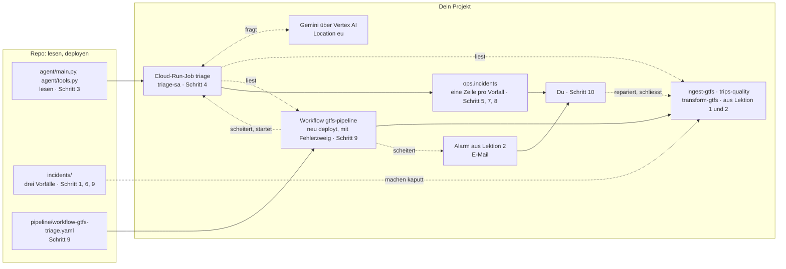

# Lektion 4: Der Agent im Betrieb

## Worum es geht

Nach Lektion 3 laufen zwei Workflows, einer zweimal pro Woche, einer jeden Tag. Scheitert
einer, kommt eine E-Mail. Sie sagt: `gtfs-pipeline fehlgeschlagen`, und sonst nichts. Wer
sie um sechs Uhr morgens bekommt, öffnet die Console, sucht die Execution, liest den
Fehlertext, klickt in den Job, in die Logs, in den Scan, in IAM, vergleicht mit dem letzten
Lauf, der funktioniert hat, und weiss nach zwanzig Minuten, was los ist. Die zwanzig Minuten
sind immer dieselben Handgriffe, nur die Reihenfolge hängt davon ab, was man als Erstes
findet.

Heute macht das ein Agent. Ein Agent ist ein Sprachmodell, das nicht einmal antwortet,
sondern selbst entscheidet, was es als Nächstes nachschaut, ein Werkzeug aufruft, das
Ergebnis liest, und wieder entscheidet, bis es genug weiss. In Lektion 3 war das Modell eine
Funktion: ein Text rein, Spalten raus, einmal. Heute hat es Werkzeuge: die Execution lesen,
die Logs eines Jobs, das Audit-Log, die Regeln des Scans, die Load-Jobs einer Tabelle. Zehn
eigene Werkzeuge und das BigQuery-Werkzeug von ADK, und alle lesen nur.

Das ist die Entscheidung dieser Lektion, und sie ist dieselbe wie in Lektion 3, eine Stufe
höher: Das Modell liest, der Mensch entscheidet. Der Agent darf alles lesen und darf eine
Zeile in eine Tabelle schreiben, mit seiner Diagnose und einem Vorschlag. Er darf keine
Rolle vergeben, keinen Job deployen, nichts löschen. Nicht weil er es nicht könnte, sondern
weil wir die Grenze dort ziehen, wo ein Irrtum billig ist. Eine falsche Diagnose kostet eine
Minute Lesen. Eine falsche Reparatur kostet einen Nachmittag.

Damit es etwas zu diagnostizieren gibt, machst du heute drei Dinge absichtlich kaputt, so
wie sie im Betrieb kaputtgehen: Jemand verschärft eine Regel. Jemand deployt eine
Codeänderung, die gut klingt. Jemand räumt in IAM auf. Jedes Mal scheitert die Pipeline,
jedes Mal kommt die E-Mail aus Lektion 2, und jedes Mal liegt, wenn sie ankommt, schon eine
Diagnose in der Tabelle. Am Ende reparierst du alles selbst, mit den Vorschlägen des Agenten
in der Hand, und schliesst die drei Vorfälle. Das Schliessen bleibt bei dir.

Nichts aus Lektion 1 bis 3 wird geändert. Der Workflow `gtfs-pipeline` wird einmal neu
deployt, aus einer neuen Datei, mit denselben Schritten und einem Fehlerzweig dazu.

## Die Karte



## Bevor es losgeht

Voraussetzung ist Lektion 2: `gtfs-pipeline` läuft mit Qualitätsschranke, `workflow-sa` ist
da, der Alarm schickt E-Mails, und in `raw.trips` liegen mindestens zwei Versionen. Aus
Lektion 3 brauchst du nur die Verbindung `vertex-ai`, für einen einzigen Aufruf in Schritt
2. Wer Lektion 3 nicht gemacht hat, legt sie dort in drei Befehlen an. Wer Lektion 1 und 2
nicht gemacht hat: [SCHNELLSTART.md](SCHNELLSTART.md) stellt diesen Stand in einer Stunde her.

Im Terminal, im Ordner `daeng-hs26-gcp`:

```bash
git pull
gcloud auth login
gcloud auth application-default login
claude
```

Das Repo hat neue Dateien (`agent/`, `incidents/`, `pipeline/workflow-gtfs-triage.yaml`) und
neue Zeilen in `CLAUDE.md` und `.claude/settings.json`. Dein `transform/` und deine Kopie
von `checks/trips_quality.yaml` mit deiner Projekt-ID bleiben vom `git pull` unberührt.
Claude Code neu starten, damit es die neuen Regeln liest.

Eine Regel ist neu und wichtig: `incidents/` enthält Befehle, die die Pipeline absichtlich
kaputt machen. Claude Code führt sie nur aus, wenn du es ausdrücklich verlangst, und sagt
vorher, was sie tun. Heute verlangst du es dreimal.

Prüfe, dass dein Projekt aktiv ist, und dass gerade keine Execution von `gtfs-pipeline`
läuft:

```bash
gcloud config get-value project
gcloud workflows executions list gtfs-pipeline --location=europe-west6 --limit=1
```

Wie bisher: Prompt einfügen, jeden Befehl lesen und mit der Liste vergleichen, freigeben, in
der Console nachschauen.

---

## 1. Der erste Vorfall beginnt jetzt

**Warum.** Die Pipeline braucht sieben Minuten, bis sie einen Fehler in den Daten bemerkt:
drei Minuten Ingest, zwei Minuten Scan, dann schliesst die Schranke. Darum beginnt der erste
Vorfall, bevor der Agent da ist. Du schaust ihn dir in Schritt 5 an.

Die Geschichte dazu: Ein Kollege findet, eine Million Zeilen sei als Untergrenze zu lax. In
der Console zeigt `raw.trips` gut fünf Millionen Zeilen, also setzt er die Schwelle auf drei
Millionen, "immer noch mit Reserve, aber wir merken es, wenn etwas fehlt". Was er überlesen
hat: Die Regel zählt pro Version, nicht pro Tabelle, und eine Version hat 2.6 Millionen.
Dass damit jede Lieferung durchfällt, merkt er nicht, weil der Scan erst beim nächsten Lauf
der Pipeline läuft. Du spielst den Kollegen, mit einer Kopie der Regeldatei in `/tmp`. Die
Datei im Repo bleibt, wie sie ist, du brauchst sie in Schritt 6 zum Zurückstellen.

Prompt:

```text
Lies incidents/README.md, Abschnitt B, und erkläre mir in zwei Sätzen, was passieren wird.
Dann: Erzeuge aus checks/trips_quality.yaml eine Kopie in /tmp, in der die Schwelle der
Regel min-one-million-rows-per-version 3000000 statt 1000000 ist, und ändere die Datei im
Repo nicht. Aktualisiere den Scan trips-quality mit dieser Kopie. Starte dann gtfs-pipeline,
ohne auf das Ende zu warten (gcloud workflows execute), und zeige mir die ID der
Execution.
```

Befehle:

```bash
sed 's/< 1000000/< 3000000/' checks/trips_quality.yaml > /tmp/trips_quality_3m.yaml

gcloud dataplex datascans update data-quality trips-quality --location=europe-west6 \
  --data-quality-spec-file=/tmp/trips_quality_3m.yaml

gcloud workflows execute gtfs-pipeline --location=europe-west6
```

Claude Code merkt vielleicht an, dass die Regel damit für alle Versionen scheitern wird,
nicht nur für eine. Stimmt, und das ist später ein Hinweis für den Agenten.

Console: [BigQuery](https://console.cloud.google.com/bigquery) → `raw` → `trips` → Tab
**Data Quality** → der Scan `trips-quality`: die Regel `min-one-million-rows-per-version`
zeigt im SQL `< 3000000`. [Workflows](https://console.cloud.google.com/workflows) →
`gtfs-pipeline`: eine Execution ist aktiv, im Schritt `run_ingest`.

Checkpoint: Execution `ACTIVE`, Regel steht auf drei Millionen. Weiter mit Schritt 2, die
Pipeline arbeitet derweil.

---

## 2. Die Funktion zuerst

**Warum.** Bevor du den Agenten anschaust, probierst du das Werkzeug aus Lektion 3 an der
Aufgabe von heute: Gib dem Modell den Fehlertext der Execution und frag nach Ursache und
Massnahme. Das ist die Funktion, einmal aufgerufen, ohne Werkzeuge. Du wirst sehen, dass die
Antwort vernünftig klingt, und warum sie trotzdem nicht reicht.

Der Fehlertext ist der aus `check_gate`, so wie er in sieben Minuten in deiner Execution
stehen wird. Du gibst ihn als Text in die Abfrage, du musst nicht warten.

Falls die Verbindung `vertex-ai` aus Lektion 3 in deinem Projekt fehlt, zuerst dieser
Prompt:

```text
Aktiviere die APIs bigqueryconnection und aiplatform. Lege in BigQuery eine Verbindung
vertex-ai vom Typ Cloud Resource in europe-west6 an, zeige mir ihren Service-Account und gib
ihm auf dem Projekt die Rolle roles/aiplatform.user, sonst nichts. Das Recht braucht zwei
bis drei Minuten.
```

Dann der Prompt für alle:

```text
Rufe AI.GENERATE einmal auf, ohne Tabelle, auf diesen Text als Literal: "Qualitätsschranke
geschlossen. Scan-Job projects/PROJEKT/locations/europe-west6/dataScans/trips-quality/jobs/7a1,
Zustand SUCCEEDED, nicht bestandene Regeln: ["min-one-million-rows-per-version"]". Der Prompt
sagt dem Modell, dass es Betriebsingenieur einer Datenpipeline ist, in der ein Cloud Workflow
Daten lädt, mit einem Dataplex-Scan prüft und transformiert, und dass es zu dieser Meldung
Kategorie, Ursache und Massnahme nennen soll. Verbindung vertex-ai, Endpunkt die URL der
EU-Multiregion für gemini-3.8-flash, Temperatur 0, output_schema mit category STRING (enum
Konfigurationsfehler, Code-Änderung, Regel zu streng, Berechtigung, Daten geändert, unklar),
cause STRING und proposed_fix STRING. Zeige mir die drei Spalten und status.
```

Die Abfrage, die Claude Code daraus baut, im Kern:

```sql
SELECT g.category, g.cause, g.proposed_fix, g.status
FROM UNNEST([AI.GENERATE(
  ('Du bist Betriebsingenieur einer Datenpipeline. Ein Cloud Workflow lädt Daten nach ',
   'BigQuery, prüft sie mit einem Dataplex-Scan und transformiert sie. Eine Execution ist ',
   'mit dieser Meldung gescheitert. Nenne Kategorie, Ursache und Massnahme.\nMeldung: ',
   'Qualitätsschranke geschlossen. Scan-Job projects/daeng-KÜRZEL-XXXX/locations/europe-west6/dataScans/trips-quality/jobs/7a1, ',
   'Zustand SUCCEEDED, nicht bestandene Regeln: ["min-one-million-rows-per-version"]'),
  connection_id => 'daeng-KÜRZEL-XXXX.europe-west6.vertex-ai',
  endpoint => 'https://aiplatform.eu.rep.googleapis.com/v1/projects/daeng-KÜRZEL-XXXX/locations/eu/publishers/google/models/gemini-3.8-flash',
  model_params => JSON '{"generation_config": {"temperature": 0}}',
  output_schema => """
    category STRING NOT NULL OPTIONS(`enum` = ['Konfigurationsfehler', 'Code-Änderung', 'Regel zu streng', 'Berechtigung', 'Daten geändert', 'unklar']),
    cause STRING NOT NULL,
    proposed_fix STRING NOT NULL
  """
)]) AS g
```

Was du siehst: eine Kategorie, eine Ursache in einem Satz, eine Massnahme. Welche Kategorie,
hängt vom Lauf ab. Meist `Daten geändert` ("die Lieferung hatte weniger als eine Million
Zeilen") oder `unklar`, manchmal `Regel zu streng`. Alle drei sind aus dem Text heraus
vertretbar, und genau das ist der Punkt: Im Text steht, welche Regel gescheitert ist. Ob die
Lieferung klein war oder die Regel gross, steht nicht im Text. Das steht in der
Scan-Historie, im Audit-Log, in den Zeilenzahlen der Partitionen. Die Funktion hat den Text.
Der Agent hat die Werkzeuge, um nachzuschauen.

Console: noch nichts.

Checkpoint: eine Zeile mit `category`, `cause`, `proposed_fix`, `status` leer. Und ein
Grund, warum es den Agenten braucht.

---

## 3. Was ein Agent ist

**Warum.** Der Agent ist fertig geschrieben, zwei Dateien, du liest sie. Nicht, um sie zu
ändern, sondern um die vier Teile zu kennen, aus denen jeder Agent besteht, und um zu sehen,
wo die Grenze steht, über die er nicht darf.

**Die vier Teile.** Erstens das Schema, die Klasse `Diagnose`: genau diese Felder, genau
diese Werte. Eine Kategorie aus sechs, die Fakten getrennt von den Schlüssen, die Konfidenz
darf nur `hoch` sein, wenn die Ursache gelesen wurde und nicht erschlossen. Das Modell muss
das Schema ausfüllen, es gibt kein Freitextfeld, in dem es ausweichen könnte. Zweitens die
Anweisung, `INSTRUCTION`: wie ein Mensch bei einem Vorfall vorgeht, in fünf Schritten.
Execution lesen, den gescheiterten Schritt lesen, mit der Historie vergleichen, nach
Änderungen der letzten Tage suchen, die einfachste Erklärung wählen. Nichts darin nennt
einen bestimmten Vorfall. Die Anweisung beschreibt die Methode, nicht die Fälle von heute.
Drittens die Werkzeuge in `tools.py`: zehn Python-Funktionen. Das Modell sieht ihren Namen,
den Docstring und die Parameter, und entscheidet selbst, wann es welche aufruft. Darum sind
die Docstrings auf Deutsch und sagen genau, was zurückkommt, sie sind die
Bedienungsanleitung für das Modell. Viertens der Lauf: `triage()` baut den Agenten, gibt ihm
einen Satz ("Execution soundso ist gescheitert") und lässt ihn arbeiten, bis das Schema
gefüllt ist.

**Was ADK dabei tut.** Die Schleife, in der das Modell ein Werkzeug wählt, das Werkzeug
läuft, das Ergebnis zurück in den Prompt wandert, und das Modell wieder wählt, schreibt
niemand mehr von Hand. Googles Agent Development Kit stellt sie: `LlmAgent` bekommt Modell,
Anweisung, Werkzeuge und Schema, `InMemoryRunner` lässt ihn laufen. Das BigQuery-Werkzeug
kommt gleich mit, `BigQueryToolset`, mit Schreibsperre (`WriteMode.BLOCKED`) und einer
Obergrenze von einem Gigabyte pro Abfrage. Der Agent kann also SQL schreiben, aber kein
`DELETE`, und keine Abfrage, die teuer wird.

**Drei Regeln für Werkzeuge**, oben in `tools.py`: Feste Namen, das Modell wählt aus dem,
was die Pipeline hat, es kann keine Ressource erfinden. Knappe Antworten, Felder statt
Rohtext, feste Obergrenzen, denn jede Antwort wandert bei jedem weiteren Modellaufruf mit.
Und kein Absturz: ein Fehler im Werkzeug kommt als Ergebnis zurück, nicht als Exception,
sonst bricht der ganze Lauf ab, und das Modell kann nicht anders weitersuchen. Das macht der
`safe`-Wrapper.

**Die Grenze.** Kein Werkzeug schreibt, deployt, startet oder löscht. Die eine Zeile in
`ops.incidents` schreibt `write_row()`, nach dem Lauf des Modells, aus dem Programm heraus.
Das Modell hat dafür kein Werkzeug, und der Service-Account des Jobs hat ausser auf `ops`
nirgends Schreibrecht. Beides zusammen ist die Grenze: einmal im Code, einmal in IAM.

Prompt:

```text
Lies agent/main.py, agent/tools.py und agent/SPEC.md. Erkläre mir in je einem Satz: was die
Klasse Diagnose festlegt, was in INSTRUCTION steht und was absichtlich nicht, welche
Werkzeuge der Agent hat (die eigenen und die von ADK) und was keines davon kann, wer die
Zeile in ops.incidents schreibt,
und was MAX_LLM_CALLS begrenzt. Ändere nichts.
```

Was Claude Code nennen sollte: Das Schema erzwingt eine von sechs Kategorien und die
Trennung von Fakten und Schlüssen. Die Anweisung beschreibt ein Vorgehen und zwei
Standardabfragen, aber keinen Vorfall. Die Werkzeuge lesen Workflow, Jobs, Logs, Audit-Log,
Scan, Builds und Load-Jobs, keines ändert etwas. Die Zeile schreibt das Programm, nicht das
Modell. `MAX_LLM_CALLS` begrenzt die Anzahl Modellaufrufe pro Diagnose auf 30, gegen eine
Schleife, nicht gegen Kosten. Die Kosten entstehen durch die Werkzeugantworten im Prompt,
und die begrenzen die Werkzeuge selbst. Daneben gibt es ein Zeitbudget von zehn Minuten:
Läuft es ab, schreibt der Job trotzdem eine Zeile, Kategorie `unklar`, mit dem, was er bis
dahin gelesen hat. Der Agent endet nie ohne Zeile, das ist die Regel für alles, was
unbeaufsichtigt läuft.

Was `tool_calls` ist: Der Agent schreibt zu jeder Diagnose mit, welche Werkzeuge er in
welcher Reihenfolge aufgerufen hat, mit Argumenten und dem Anfang jeder Antwort. Das ist der
Nachweis. Jeder Satz in der Diagnose lässt sich auf eine Antwort zurückführen, die der Agent
gelesen hat.

Console: noch nichts.

Checkpoint: Claude Code hat die vier Teile, die zehn eigenen Werkzeuge plus BigQuery und
die Grenze genannt.

---

## 4. Identität, Deploy, Selbsttest

**Warum.** Der Agent läuft als Cloud-Run-Job `triage`, wie der Ingest und der Transform. Er
bekommt eine eigene Identität, `triage-sa`, mit Leserollen auf allem, was er anschauen soll,
und Schreibrecht nur auf dem Dataset `ops`. Das Dataset legst du an, nicht der Job. Die
Tabelle darin legt der Job beim ersten Lauf an, dafür hat er das Recht.

**Die Rollen, und warum jede.** Workflows Viewer, Cloud Run Viewer, Logs Viewer: Execution,
Jobs und Logs lesen. Dataplex DataScan DataViewer: Regeln und Ergebnisse des Scans. Cloud
Build Viewer: wann wer welchen Job deployt hat. BigQuery Job User: Abfragen ausführen.
BigQuery Metadata Viewer: Tabellen und Partitionen sehen, mit Zeilenzahlen, aber ohne
Zeilen. BigQuery Resource Viewer: die Load-Jobs anderer Konten sehen, das steht in keiner
`INFORMATION_SCHEMA`-Sicht. Agent Platform User: Gemini aufrufen. Und BigQuery Data Editor
nur auf `ops`. Was fehlt: eine Leserolle auf `raw`. Der Agent sieht, dass eine Partition 5.2
Millionen Zeilen hat, aber keine einzige davon. Für eine Diagnose reicht das, und es ist der
Unterschied zwischen einem Werkzeug, das man einem Modell gibt, und einem, das man ihm nicht
gibt.

Ein Unterschied zu Lektion 3: Dort rief BigQuery das Modell auf, mit der Identität der
Verbindung. Hier ruft der Job das Modell selbst auf, mit seiner eigenen Identität, über
Vertex AI in der Location `eu`. Darum braucht `triage-sa` Agent Platform User, und darum
steht in der Umgebung des Jobs `GOOGLE_CLOUD_LOCATION=eu`.

Prompt 1:

```text
Lege das Dataset ops in europe-west6 an. Lege einen Service-Account triage-sa an und warte,
bis describe ihn zeigt. Gib ihm auf dem Projekt die Rollen roles/workflows.viewer,
roles/run.viewer, roles/logging.viewer, roles/dataplex.dataScanDataViewer,
roles/cloudbuild.builds.viewer, roles/bigquery.jobUser, roles/bigquery.metadataViewer,
roles/bigquery.resourceViewer und roles/aiplatform.user, und auf dem Dataset ops die Rolle
BigQuery Data Editor (Datasets haben kein add-iam-policy-binding: bq show nach einer Datei,
access ergänzen, bq update --source). Keine Rolle auf dem Dataset raw. Deploye dann agent/ als
Cloud-Run-Job triage in europe-west6 mit triage-sa, 1 GiB Speicher, 1 CPU, Task-Timeout 15
Minuten, keine Wiederholungen, und den Umgebungsvariablen GOOGLE_CLOUD_PROJECT (meine
Projekt-ID), GOOGLE_CLOUD_LOCATION=eu und GOOGLE_GENAI_USE_VERTEXAI=1.
```

Befehle:

```bash
bq mk --location=europe-west6 ops

gcloud iam service-accounts create triage-sa --display-name="Triage-Agent"

gcloud iam service-accounts describe \
  triage-sa@daeng-KÜRZEL-XXXX.iam.gserviceaccount.com

for role in roles/workflows.viewer roles/run.viewer roles/logging.viewer \
  roles/dataplex.dataScanDataViewer roles/cloudbuild.builds.viewer \
  roles/bigquery.jobUser roles/bigquery.metadataViewer roles/bigquery.resourceViewer \
  roles/aiplatform.user; do
  gcloud projects add-iam-policy-binding daeng-KÜRZEL-XXXX \
    --member="serviceAccount:triage-sa@daeng-KÜRZEL-XXXX.iam.gserviceaccount.com" \
    --role="$role"
done

bq show --format=prettyjson daeng-KÜRZEL-XXXX:ops > /tmp/ops-dataset.json
# Datei: in access einen Eintrag {"role": "WRITER", "userByEmail": "triage-sa@..."} ergänzen
bq update --source /tmp/ops-dataset.json daeng-KÜRZEL-XXXX:ops

gcloud run jobs deploy triage --source agent --region europe-west6 \
  --service-account=triage-sa@daeng-KÜRZEL-XXXX.iam.gserviceaccount.com \
  --set-env-vars=GOOGLE_CLOUD_PROJECT=daeng-KÜRZEL-XXXX,GOOGLE_CLOUD_LOCATION=eu,GOOGLE_GENAI_USE_VERTEXAI=1 \
  --memory=1Gi --cpu=1 --task-timeout=15m --max-retries=0
```

Neun Mal dieselbe Zeile für die Rollen, Claude Code macht daraus vielleicht eine Schleife
wie oben, vielleicht neun Befehle. Beides ist in Ordnung, lies die Rollen. Für das Dataset
gibt es kein `add-iam-policy-binding`, darum derselbe Dreischritt wie bei der Scan-Policy in
Lektion 2: lesen, Datei ergänzen, zurückschreiben. `WRITER` in der Datei ist BigQuery Data
Editor. `--max-retries=0` ist wichtig: Scheitert eine Triage, soll sie nicht dreimal
wiederholt werden, jede Wiederholung kostet Modellaufrufe.

Der Build dauert drei bis fünf Minuten, das Image ist grösser als beim Ingest, ADK bringt
einiges mit. Währenddessen: [IAM](https://console.cloud.google.com/iam-admin/iam) zeigt
`triage-sa` mit neun Rollen. [BigQuery](https://console.cloud.google.com/bigquery) → Dataset
`ops` → Freigabe (englisch Sharing) → Berechtigungen zeigt `triage-sa` als BigQuery Data
Editor, nur hier.

Prompt 2, wenn der Deploy fertig ist:

```text
Starte den Job triage einmal mit dem Argument --selftest und warte. Zeige mir dann alle
Logzeilen dieser Execution, die mit SELFTEST beginnen.
```

Befehle:

```bash
gcloud run jobs execute triage --region europe-west6 --wait --args=--selftest

gcloud logging read 'resource.type="cloud_run_job" AND resource.labels.job_name="triage" AND textPayload:"SELFTEST"' \
  --limit=20 --order=asc --format="value(textPayload)"
```

Der Selbsttest ruft jedes Werkzeug einmal auf, unter der Identität des Jobs, und zwei
Abfragen auf `INFORMATION_SCHEMA`, und legt die Tabelle `ops.incidents` an. Jede Zeile endet
mit `OK`. Endet eine mit `ERROR` und `403`, fehlt eine Rolle, und die Zeile sagt, welches
Werkzeug sie braucht. Das ist der Zweck des Selbsttests: Rollen prüfen, bevor der erste
Vorfall kommt, und nicht während.

Console: [Cloud Run → Jobs](https://console.cloud.google.com/run/jobs) → `triage` → eine
Execution, grün, "Ausgeführt von" dein Konto.
[BigQuery](https://console.cloud.google.com/bigquery) → `ops` → `incidents`, 19 Spalten, 0
Zeilen.

Checkpoint: alle `SELFTEST`-Zeilen `OK`, Tabelle `ops.incidents` existiert und ist leer.

---

## 5. Der erste Vorfall: die Regel

**Warum.** Inzwischen ist die Execution aus Schritt 1 gescheitert, in `check_gate`, mit dem
Text aus Schritt 2 und deinem Scan-Job darin. Jetzt bekommt der Agent die ID dieser
Execution, und sonst nichts. Keinen Fehlertext, keine Vermutung. Was er wissen will, liest
er selbst.

Prompt 1:

```text
Zeige mir die letzte Execution von gtfs-pipeline: Zustand, Beginn, Ende, und den Fehlertext.
```

Befehle:

```bash
gcloud workflows executions list gtfs-pipeline --location=europe-west6 --limit=1

gcloud workflows executions describe EXECUTION-ID --workflow=gtfs-pipeline \
  --location=europe-west6
```

Zustand `FAILED`, der Fehlertext beginnt mit `Qualitätsschranke geschlossen`, nicht
bestandene Regel `min-one-million-rows-per-version`. Die ID steht am Ende von `name`, nach
`executions/`.

Prompt 2:

```text
Starte den Job triage mit der ID dieser Execution als einzigem Argument und warte. Zeige mir
dann aus ops.incidents für diese Execution: category, confidence, what_happened, cause,
proposed_fix, und die Listen facts, inferences und where_to_look je als Zeilen.
```

Befehle:

```bash
gcloud run jobs execute triage --region europe-west6 --wait --args=EXECUTION-ID

bq query --use_legacy_sql=false \
  "SELECT category, confidence, what_happened, cause, proposed_fix, facts, inferences, where_to_look
   FROM ops.incidents WHERE workflow_execution = 'EXECUTION-ID'"
```

Die Triage dauert zwei bis drei Minuten, zwanzig Sekunden davon ist der Kaltstart, der Rest
hängt vom Tempo des Modells ab, das zwischen fünf und zwanzig Sekunden pro Aufruf
schwankt. Im Log der Execution siehst du währenddessen eine Zeile pro Werkzeugaufruf,
`WERKZEUG get_workflow_execution {"execution_id": ...}`, dann `WERKZEUG get_datascan {}`,
dann `WERKZEUG get_admin_activity {"resource": "trips-quality", ...}`, dazu pro Modellaufruf
eine Zeile `MODELL` mit seiner Dauer, und am Ende den Bericht.

Was der Agent finden sollte: Kategorie `Regel zu streng`, Konfidenz `hoch`. In den Fakten:
Die Execution scheiterte in `check_gate`, Regel `min-one-million-rows-per-version`
(`get_workflow_execution`). Die Regel prüft `COUNT(*) < 3000000` pro Partition, und sie
scheiterte für alle Partitionen, nicht für eine (`get_datascan`). Die Partitionen haben je
rund 2.6 Millionen Zeilen, wie immer (`execute_sql` auf `PARTITIONS`). Vor wenigen Minuten
hat dein Konto den Scan geändert, `UpdateDataScan`, und die Regel stand vorher auf `<
1000000` (`get_admin_activity`). Die vorigen Scan-Läufe haben bestanden. In den Schlüssen:
Die Daten sind unverändert, die Schwelle wurde über den Normalwert gehoben, deshalb fällt
jede Version durch. Vorschlag: die Regel auf die vorige Schwelle zurückstellen, dann den
Workflow einmal laufen lassen.

Drei Dinge daran. Erstens: Die Konfidenz ist `hoch`, weil die Ursache in den Fakten steht,
die Änderung der Regel ist im Audit-Log, mit Zeit und Konto. Das Modell hat sie nicht
erschlossen, es hat sie gelesen. Zweitens: Der Agent nennt, wer es war. Das ist dein Konto,
und im Betrieb wäre es das des Kollegen, und das ist kein Vorwurf, sondern die Stelle, an
der man nachfragt. Drittens: Der Vorschlag stellt einen früheren Zustand wieder her. Der
Agent schlägt nicht vor, die Daten anzupassen oder die Regel zu löschen. Das steht so in der
Anweisung, und es ist die Regel für alle Vorschläge: nur, was einen bekannten Zustand
wiederherstellt oder einen idempotenten Schritt wiederholt.

Wenn die Konfidenz `mittel` ist oder die Kategorie `Daten geändert`: Lies die Fakten. Steht
die Regeländerung drin, hat das Modell sie gelesen und anders gewichtet, und du siehst in
`facts` und `inferences`, wo es abgebogen ist. Steht sie nicht drin, hat der Agent
`get_admin_activity` für den Scan nicht aufgerufen, und `tool_calls` zeigt dir, was er
stattdessen gelesen hat. Beides ist kein Grund, etwas zu ändern. Es ist der Grund, warum die
Zeile `status: offen` hat und ein Mensch sie liest.

Console: [Cloud Run → Jobs](https://console.cloud.google.com/run/jobs) → `triage` → die
zweite Execution → Logs: die `WERKZEUG`-Zeilen und der Bericht mit Kategorie, Fakten,
Schlüssen, und am Ende die Tabelle der Werkzeuge mit Aufrufen und Zeichen, Token und Dauer.

Checkpoint: eine Zeile in `ops.incidents`, Kategorie `Regel zu streng`, `status` ist
`offen`.

---

## 6. Reparieren, und der zweite Vorfall

**Warum.** Der Agent hat vorgeschlagen, du führst aus. Für die Regel ist das ein Befehl, mit
der Datei aus dem Repo, in der die Schwelle noch stimmt. Danach beginnt der zweite Vorfall,
und der ist anders: Diesmal ändert sich kein Regelwerk und keine Rolle, sondern Code, und
der Code tut, was im Commit steht.

Die Geschichte: Ein Kollege hat bemerkt, dass der Ingest bei einem zweiten Lauf derselben
Version die Partition ersetzt. Das kommt ihm riskant vor, "da könnte etwas verloren gehen",
und er stellt auf Anhängen um. Der Patch liegt in `incidents/ingest-append.patch`, mit
seiner Begründung. Lies ihn. Er ändert ein Wort, `WRITE_TRUNCATE` wird `WRITE_APPEND`, und
die Begründung klingt vernünftig. Was passieren wird: Der nächste Lauf lädt dieselbe
Version, die schon in `raw.trips` liegt, und hängt sie an sich selbst an. Jede `trip_id` ist
dann doppelt, und die Regel `trip-id-unique-per-version` aus Lektion 1 schliesst die
Schranke. Der Mart behält die letzte gute Version, so war es gedacht.

Prompt 1:

```text
Stelle den Scan trips-quality mit checks/trips_quality.yaml aus dem Repo wieder her, das ist
meine Kopie mit meiner Projekt-ID, und zeige mir danach die Schwelle der Regel
min-one-million-rows-per-version.
```

Befehle:

```bash
gcloud dataplex datascans update data-quality trips-quality --location=europe-west6 \
  --data-quality-spec-file=checks/trips_quality.yaml

gcloud dataplex datascans describe trips-quality --location=europe-west6 --view=FULL \
  --format="value(dataQualitySpec.rules[4].sqlAssertion.sqlStatement)"
```

Prompt 2:

```text
Lies incidents/README.md, Abschnitt C, und incidents/ingest-append.patch, und erkläre mir in
zwei Sätzen, was der Patch ändert und warum die Begründung im Patch trotzdem falsch ist.
Dann wende den Patch auf ingest/main.py an, deploye ingest-gtfs neu aus ingest/ wie in
Lektion 1 (ingest-sa, 2 GiB, 1 CPU, Task-Timeout 30 Minuten, keine Wiederholungen), und
starte gtfs-pipeline, ohne auf das Ende zu warten (gcloud workflows execute). Committe
nichts.
```

Befehle:

```bash
git apply incidents/ingest-append.patch

gcloud run jobs deploy ingest-gtfs --source ingest --region europe-west6 \
  --service-account=ingest-sa@daeng-KÜRZEL-XXXX.iam.gserviceaccount.com \
  --memory=2Gi --cpu=1 --task-timeout=30m --max-retries=0

gcloud workflows execute gtfs-pipeline --location=europe-west6
```

Was Claude Code zur Begründung sagen sollte: Ersetzen war Absicht. Die Partition gehört zu
genau einer Version, ein zweiter Lauf derselben Version bringt dieselben Zeilen, und
Ersetzen macht den zweiten Lauf harmlos. Anhängen macht ihn zur Verdopplung. Das stand als
Kommentar direkt über der Zeile, der Patch lässt den Kommentar stehen und ändert die Zeile
darunter. Lies `git diff ingest/main.py` einmal selbst, dieser Widerspruch zwischen
Kommentar und Code ist typisch für Änderungen, die in Eile gemacht wurden.

Der Build dauert drei Minuten, dann läuft die Pipeline acht Minuten, bis die Schranke
schliesst. Schritt 7 braucht die Pipeline nicht.

Console: [Cloud Build → Verlauf](https://console.cloud.google.com/cloud-build/builds): ein
neuer Build für `ingest-gtfs`. [Cloud Run → Jobs](https://console.cloud.google.com/run/jobs)
→ `ingest-gtfs` → Tab Revisionen oder YAML: eine neue Generation, `Zuletzt geändert von`
dein Konto, eben.

Checkpoint: Regel steht wieder auf `< 1000000`, `git diff` zeigt eine geänderte Zeile in
`ingest/main.py`, Build grün, Execution `ACTIVE`.

---

## 7. Was in der Tabelle steht

**Warum.** Die Zeile in `ops.incidents` ist mehr als die Diagnose. Sie hält fest, was der
Agent gelesen hat, in welcher Reihenfolge, wie lange es dauerte und was es gekostet hat. Das
ist der Teil, den ein Team braucht, wenn es einem Agenten vertrauen will: nicht ob er recht
hatte, sondern woher er es weiss.

Prompt:

```text
Zeige mir aus ops.incidents für den neuesten Vorfall: category, confidence,
duration_seconds, prompt_tokens, output_tokens, model_version, und darunter die
Werkzeugaufrufe aus tool_calls in ihrer Reihenfolge mit tool, args und chars, je eine Zeile.
```

Befehle:

```bash
bq query --use_legacy_sql=false \
  "SELECT category, confidence, duration_seconds, prompt_tokens, output_tokens, model_version
   FROM ops.incidents ORDER BY created_at DESC LIMIT 1"

bq query --use_legacy_sql=false \
  "SELECT pos, JSON_VALUE(c, '$.tool') AS tool, JSON_QUERY(c, '$.args') AS args,
          INT64(c.chars) AS chars
   FROM ops.incidents, UNNEST(JSON_QUERY_ARRAY(tool_calls)) AS c WITH OFFSET AS pos
   WHERE created_at = (SELECT MAX(created_at) FROM ops.incidents)
   ORDER BY pos"
```

Was du siehst: sechs bis zehn Werkzeugaufrufe. Der erste ist immer `get_workflow_execution`,
weil die Anweisung so beginnt. Dann meist `get_datascan`, weil der Fehler aus `check_gate`
kam, dann `get_admin_activity` für den Scan, dann eine Abfrage auf `PARTITIONS`, vielleicht
`list_workflow_executions` für den Vergleich. Der Agent geht den Weg, den du in Lektion 2
von Hand gegangen wärst, nur ohne zu klicken. Die Spalte `chars` sagt, wie viel Text jedes
Werkzeug zurückgab. Das ist der Preis: Alles, was früh gelesen wird, geht in jeden weiteren
Modellaufruf mit.

Was es gekostet hat, in der Musterlösung: 80 bis 150 Sekunden, davon zehn Kaltstart, einige
Zehntausend bis gut hunderttausend Prompt-Token über alle Aufrufe zusammen, ein paar Tausend
Output-Token, fünf bis sieben Rappen. Für den Preis eines Kaffees pro Monat könnte der Agent
jeden Werktag einen Vorfall untersuchen. Die zwanzig Minuten aus der Einleitung kosten mehr.

`prompt_tokens` ist die Summe über alle Modellaufrufe. Bei acht Aufrufen zählt der erste
Prompt achtmal, plus jedes Mal die bisherigen Werkzeugantworten. Darum wachsen die Kosten
nicht mit der Anzahl Werkzeuge, sondern mit dem Quadrat der Werkzeugantworten, und darum
sind die Antworten knapp.

Console: [BigQuery](https://console.cloud.google.com/bigquery) → `ops` → `incidents` → Tab
Vorschau. Die Spalte `tool_calls` ist JSON, in der Vorschau aufklappbar.

Checkpoint: eine Zeile, `status` `offen`, `tool_calls` mit sechs bis zehn Einträgen, der
erste `get_workflow_execution`.

---

## 8. Der zweite Vorfall: der Code

**Warum.** Die Execution aus Schritt 6 ist inzwischen gescheitert, in `check_gate`, Regel
`trip-id-unique-per-version`. Derselbe Text wie in Schritt 5, bis auf den Namen der Regel.
Die Ursache ist eine ganz andere, und sie steht nirgends direkt. Der Agent kann den Code
nicht lesen, er hat kein Werkzeug für das Repo. Er sieht, was sich anders verhält, und muss
daraus schliessen, was sich geändert hat.

Prompt:

```text
Prüfe, dass die letzte Execution von gtfs-pipeline gescheitert ist und welche Regel sie
nennt. Starte dann triage mit ihrer ID und warte. Zeige mir aus ops.incidents für diese
Execution dieselben Spalten wie in Schritt 5, dazu die Anzahl Einträge in tool_calls und
duration_seconds.
```

Befehle:

```bash
gcloud workflows executions list gtfs-pipeline --location=europe-west6 --limit=1

gcloud workflows executions describe EXECUTION-ID --workflow=gtfs-pipeline \
  --location=europe-west6

gcloud run jobs execute triage --region europe-west6 --wait --args=EXECUTION-ID

bq query --use_legacy_sql=false \
  "SELECT category, confidence, what_happened, cause, proposed_fix, facts, inferences,
          where_to_look, ARRAY_LENGTH(JSON_QUERY_ARRAY(tool_calls)) AS tool_calls, duration_seconds
   FROM ops.incidents WHERE workflow_execution = 'EXECUTION-ID'"
```

Ist die Execution grün statt rot: Dann hat der Publisher seit deinem letzten Lauf eine neue
Version veröffentlicht, und der erste Lauf mit Anhängen hat sie in eine leere Partition
geschrieben, sauber. Starte den Workflow nochmals, der zweite Lauf hängt sie an sich selbst
an. Acht Minuten.

Diese Triage dauert länger, drei bis acht Minuten, mit fünfzehn bis zwanzig
Werkzeugaufrufen. Der Agent sucht. Er liest den Scan (Regel `trip-id-unique-per-version`,
Duplikate in einer Partition), die Partitionen (die neueste hat 5.2 Millionen Zeilen, die
anderen 2.6), die Audit-Logs von Workflow, Scan und Jobs (ein Deploy von `ingest-gtfs` durch
dein Konto, kurz vor dem Lauf), die Builds (einer, für `ingest-gtfs`), die Executions des
Ingest-Jobs und deren Logzeilen (der Job meldet 2.6 Millionen geladene Zeilen, wie immer),
und schliesslich die Load-Jobs (`get_load_jobs`: der letzte mit `WRITE_APPEND`, alle vorigen
mit `WRITE_TRUNCATE`).

Was der Agent finden sollte: Kategorie `Code-Änderung`, Konfidenz `hoch` oder `mittel`. In
den Fakten: Duplikate in der neuesten Partition, doppelte Zeilenzahl, ein Deploy des
Ingest-Jobs vor dem Lauf, der letzte Load-Job mit `WRITE_APPEND` statt `WRITE_TRUNCATE`. Im
Schluss: Das neue Image hängt an statt zu ersetzen, deshalb liegt die Version doppelt.
Vorschlag: den Ingest-Job aus dem bekannten Code neu deployen und den Workflow einmal laufen
lassen, weil `WRITE_TRUNCATE` die Partition dann ersetzt. Nicht: die Duplikate löschen.

Konfidenz `mittel` ist hier richtig, auch wenn die Diagnose stimmt. Die Codeänderung selbst
hat der Agent nicht gelesen, er hat den Schreibmodus des Load-Jobs gelesen und den Deploy,
und das Dazwischen ist ein Schluss. Dass er das als Schluss ausweist und nicht als Fakt, ist
die Regel aus dem Schema, und sie ist wichtiger als die Kategorie.

Und der Vorschlag: In einem Probelauf während der Entwicklung schlug der Agent hier auch vor,
die doppelten Zeilen zu bereinigen. Das wäre Handarbeit mit `DELETE` auf einer
Rohdatentabelle, und unnötig, weil der nächste Lauf die Partition ohnehin ersetzt, sobald der
Code stimmt. Seither steht in der Anweisung: keine Bereinigung von Daten vorschlagen, solange
nicht belegt ist, dass der nächste Lauf sie nicht ersetzt. Eine Zeile in der Anweisung, aus
einem Fehler des Agenten. So wächst eine Anweisung, und sie wächst im Repo, wo man sie lesen
kann.

Console: [Cloud Run → Jobs](https://console.cloud.google.com/run/jobs) → `triage` → die
dritte Execution → Logs. Die Liste der `WERKZEUG`-Zeilen ist diesmal lang, und du siehst, wo
der Agent fündig wurde: nach `get_load_jobs` kommen nur noch ein, zwei Aufrufe, dann der
Bericht.

Checkpoint: zweite Zeile in `ops.incidents`, Kategorie `Code-Änderung`, Vorschlag "neu
deployen und einmal laufen lassen", kein `DELETE`.

---

## 9. In den Workflow, und der dritte Vorfall

**Warum.** Bis jetzt hast du die Triage gestartet. Im Betrieb startet sie der Workflow
selbst, in dem Moment, in dem er scheitert. `pipeline/workflow-gtfs-triage.yaml` ist
derselbe Workflow wie in Lektion 2, die Schritte zwischen `init` und `done` sind
unverändert, nur in einen `try`-Block gerückt. Im `except`-Zweig startet er den Job `triage`
mit seiner eigenen Execution-ID und wirft den Fehler danach weiter. Die Execution scheitert
also wie vorher, der Alarm aus Lektion 2 schickt wie vorher seine E-Mail, aber wenn sie
ankommt, liegt die Diagnose schon da.

Zwei Dinge in der Datei sind Absicht. Der Workflow gibt dem Agenten nur die ID, nicht den
Fehlertext, nicht eine Vermutung, damit der Agent liest, was ist, und nicht, was der
Workflow meint. Und der Start der Triage steht in einem eigenen `try`: Scheitert er, etwa
weil eine Rolle fehlt, darf das den eigentlichen Fehler nicht verdecken. Dann steht eine
Warnung im Log, und die E-Mail kommt trotzdem.

Der dritte Vorfall ist der schnellste: Jemand räumt in IAM auf und entfernt `workflow-sa`
die Rolle Cloud Run Invoker auf `ingest-gtfs`, "der Workflow braucht das doch nicht, der Job
hat seinen eigenen Account". Der nächste Lauf scheitert in Sekunden, mit 403, bevor
irgendetwas geladen wird. Der Entzug braucht aber bis zu zwei Minuten, bis er überall gilt.
Darum entfernst du die Rolle zuerst, deployst dann den Workflow, und startest erst danach.

Prompt 1:

```text
Lies pipeline/workflow-gtfs-triage.yaml und vergleiche mit pipeline/workflow.yaml. Erkläre
mir in je einem Satz, was im except-Zweig passiert, was der Job triage als Argument bekommt,
warum der Start der Triage einen eigenen try-Block hat, und warum der Fehler am Ende
weitergeworfen wird. Ändere nichts.
```

Prompt 2:

```text
Lies incidents/README.md, Abschnitt D. Entferne dann workflow-sa die Rolle Cloud Run Invoker
auf dem Job ingest-gtfs und sag mir die Uhrzeit. Gib workflow-sa auf dem Job triage die
Rolle roles/run.jobsExecutorWithOverrides, nicht Invoker: der Workflow startet triage mit
einem Argument, und das ist ein Override. Deploye pipeline/workflow-gtfs-triage.yaml als
Workflow gtfs-pipeline in europe-west6, derselbe Name wie bisher, mit workflow-sa und
call-log-level log-all-calls. Starte ihn noch nicht.
```

Befehle:

```bash
gcloud run jobs remove-iam-policy-binding ingest-gtfs --region=europe-west6 \
  --member="serviceAccount:workflow-sa@daeng-KÜRZEL-XXXX.iam.gserviceaccount.com" \
  --role="roles/run.invoker"

gcloud run jobs add-iam-policy-binding triage --region=europe-west6 \
  --member="serviceAccount:workflow-sa@daeng-KÜRZEL-XXXX.iam.gserviceaccount.com" \
  --role="roles/run.jobsExecutorWithOverrides"

gcloud workflows deploy gtfs-pipeline --source=pipeline/workflow-gtfs-triage.yaml \
  --location=europe-west6 \
  --service-account=workflow-sa@daeng-KÜRZEL-XXXX.iam.gserviceaccount.com \
  --call-log-level=log-all-calls
```

Warum nicht Invoker wie bei den anderen Jobs: Invoker erlaubt `run.jobs.run`, einen Job so
starten, wie er deployt ist. Die Execution-ID als Argument ist ein Override, und dafür gibt
es eine eigene Berechtigung, `run.jobs.runWithOverrides`, in der Rolle Cloud Run Jobs
Executor with Overrides. Wer dem Workflow nur Invoker gibt, sieht im Log `Triage nicht
gestartet` mit einem 403, und die E-Mail kommt trotzdem, das ist der innere `try`-Block.

Console, während du wartest: [Workflows](https://console.cloud.google.com/workflows) →
`gtfs-pipeline` → Tab Quelle: eine neue Revision, im Diagramm der `try`-Block mit dem
`except`-Zweig rechts, `start_triage` und `rethrow`. Der Scheduler-Job aus Lektion 2 zeigt
weiter auf diesen Workflow, er hat denselben Namen.

Zwei Minuten nach dem ersten Befehl, Prompt 3:

```text
Starte gtfs-pipeline und warte auf das Ende. Erwartung: Die Execution scheitert innert
Sekunden mit 403 beim Start von ingest-gtfs. Zeige mir den Fehlertext und dann die
Executions des Jobs triage.
```

Befehle:

```bash
gcloud workflows run gtfs-pipeline --location=europe-west6

gcloud run jobs executions list --job=triage --region=europe-west6 --limit=3
```

Die Execution scheitert nach wenigen Sekunden, `PERMISSION_DENIED`, `workflow-sa` darf
`ingest-gtfs` nicht starten. Als Schritt nennt die Execution `rethrow`, nicht `run_ingest`:
Das ist die Stelle, an der der Workflow den Fehler weitergeworfen hat, und die Meldung
nennt den Job. Der Agent weiss das, sein Werkzeug sagt es ihm. In der Liste der
`triage`-Executions steht eine neue, in derselben Sekunde gestartet wie der Fehlschlag,
"Ausgeführt von" `workflow-sa`, nicht du. Drei Minuten später liegt die dritte Zeile in
`ops.incidents`: Kategorie `Berechtigung`, Konfidenz `hoch`, in den Fakten der 403 beim
Start von `ingest-gtfs` und der `SetIamPolicy`-Eintrag auf `ingest-gtfs` von deinem Konto,
mit dem entfernten Binding `roles/run.invoker serviceAccount:workflow-sa@...`. Vorschlag:
das Binding wieder setzen, dann den Workflow einmal laufen lassen.

Prompt 4, nach drei Minuten:

```text
Zeige mir aus ops.incidents die neueste Zeile: created_at, category, confidence, cause,
proposed_fix, und die Fakten als Zeilen.
```

Fünf Minuten nach dem Fehlschlag kommt die E-Mail aus Lektion 2, `gtfs-pipeline
fehlgeschlagen`, Bedingung "Workflow fehlgeschlagen". Sie ist jetzt die zweite Nachricht,
die Diagnose war zuerst da. Im Betrieb würde ein Webhook-Kanal die Zeile aus `ops.incidents`
in die E-Mail oder ins Ticket schreiben, das ist nicht Teil der Lektion.

Ist die Execution grün geworden statt rot: Der Entzug der Rolle galt noch nicht, du warst zu
schnell. Das kostet sechs Minuten, sonst nichts, danach den Workflow nochmals starten.

Console: [Cloud Run → Jobs](https://console.cloud.google.com/run/jobs) → `triage`: die neue
Execution zeigt "Ausgeführt von: workflow-sa".
[Workflows](https://console.cloud.google.com/workflows) → `gtfs-pipeline` → die rote
Execution → Logs: `run_ingest` scheitert, `start_triage` ruft `jobs.run` auf, `rethrow`
wirft den Fehler.
[Monitoring → Alerting](https://console.cloud.google.com/monitoring/alerting): nach fünf
Minuten der Vorfall.

Checkpoint: dritte Zeile in `ops.incidents`, geschrieben, ohne dass du `triage` gestartet
hast. Kategorie `Berechtigung`.

---

## 10. Der Mensch schliesst

**Warum.** Drei Zeilen mit `status: offen`, drei Vorschläge. Jeder davon ist ein Befehl, den
der Agent hätte ausführen können, und wir lassen ihn nicht. Nicht aus Misstrauen in diese
drei Diagnosen, sie waren richtig. Sondern weil die Frage "darf der Agent das selbst?" eine
Entscheidung pro Art von Massnahme ist, und nicht pro Vorfall. Eine Rolle wieder setzen ist
umkehrbar und billig, das könnte man ihm mit einer Rückfrage erlauben. Einen Job aus
bekanntem Code neu deployen auch. Daten löschen nie. Wir haben heute für alle drei dieselbe
Antwort gewählt, nein, weil wir an der Stelle anfangen, an der ein Irrtum am wenigsten
kostet. Wer die Grenze später verschiebt, verschiebt sie in `tools.py` und in IAM, und beide
Stellen sind lesbar.

Die Reparatur für die Regel hast du in Schritt 6 schon gemacht. Bleiben die Rolle und der
Code. Dann läuft der Workflow einmal grün, das ist der Beleg, und erst dann schliesst du die
drei Zeilen. Geschlossen heisst: behoben und bestätigt, nicht nur repariert.

Prompt 1:

```text
Gib workflow-sa die Rolle Cloud Run Invoker auf dem Job ingest-gtfs wieder. Nimm dann die
Änderung in ingest/main.py mit git checkout zurück und zeige mir, dass git status sauber ist.
Deploye ingest-gtfs neu aus ingest/, mit denselben Einstellungen wie in Schritt 6. Starte dann
gtfs-pipeline und warte auf das Ende, das dauert etwa sechs Minuten. Zeige mir das Ergebnis
und die Zeilen pro Partition von raw.trips.
```

Befehle:

```bash
gcloud run jobs add-iam-policy-binding ingest-gtfs --region=europe-west6 \
  --member="serviceAccount:workflow-sa@daeng-KÜRZEL-XXXX.iam.gserviceaccount.com" \
  --role="roles/run.invoker"

git checkout ingest/main.py
git status

gcloud run jobs deploy ingest-gtfs --source ingest --region europe-west6 \
  --service-account=ingest-sa@daeng-KÜRZEL-XXXX.iam.gserviceaccount.com \
  --memory=2Gi --cpu=1 --task-timeout=30m --max-retries=0

gcloud workflows run gtfs-pipeline --location=europe-west6

bq query --use_legacy_sql=false \
  "SELECT partition_id, total_rows FROM raw.INFORMATION_SCHEMA.PARTITIONS
   WHERE table_name = 'trips' ORDER BY partition_id"
```

Während der sechs Minuten: Schritt 11 lesen. Dann: Die Execution ist grün, `passed: true`,
und die neueste Partition hat wieder 2.6 Millionen Zeilen statt 5.2. `WRITE_TRUNCATE` hat
sie ersetzt, genau wie der Agent in Schritt 8 gesagt hat, und niemand hat eine Zeile
gelöscht.

Prompt 2:

```text
Setze in ops.incidents alle Zeilen mit status offen auf status geschlossen, closed_by mein
Konto (SESSION_USER()), closed_at jetzt. Zeige mir danach alle Zeilen mit created_at,
category, status, closed_by.
```

Befehle:

```bash
bq query --use_legacy_sql=false \
  "UPDATE ops.incidents
   SET status = 'geschlossen', closed_by = SESSION_USER(), closed_at = CURRENT_TIMESTAMP()
   WHERE status = 'offen'"

bq query --use_legacy_sql=false \
  "SELECT created_at, category, status, closed_by FROM ops.incidents ORDER BY created_at"
```

Das ist der Unterschied zum Alarm aus Lektion 2. Dort schloss Monitoring den Vorfall nach
fünf Minuten von selbst, weil die Metrik wieder null zählte, und wir haben gesagt:
Geschlossen heisst dort nur, Bedingung nicht mehr erfüllt. Hier schliesst niemand ausser
dir. Die Zeile bleibt `offen`, bis ein Mensch sagt, dass es behoben ist, und die Tabelle
hält fest, wer das gesagt hat. `ops.incidents` ist das Ticket, Monitoring ist der
Rauchmelder, der Agent ist der, der nachschaut, bevor du da bist.

Console: [BigQuery](https://console.cloud.google.com/bigquery) → `ops` → `incidents` →
Vorschau: drei Zeilen, drei Kategorien, alle `geschlossen`.
[Workflows](https://console.cloud.google.com/workflows) → `gtfs-pipeline`: die letzte
Execution grün, der `except`-Zweig wurde nicht betreten.

Checkpoint: Execution `SUCCEEDED`, drei Zeilen `geschlossen` mit deinem Konto in
`closed_by`, `git status` sauber.

---

## 11. Was jetzt läuft

Montag und Donnerstag läuft `gtfs-pipeline`, jeden Tag `alerts-pipeline`, wie bisher.
Scheitert `gtfs-pipeline`, passieren jetzt drei Dinge, in dieser Reihenfolge: Der Workflow
startet `triage` mit seiner Execution-ID. Ein bis drei Minuten später liegt eine Zeile in
`ops.incidents`, mit Kategorie, Fakten, Schlüssen, Vorschlag, Konfidenz und dem Nachweis,
was der Agent gelesen hat, Status `offen`. Fünf Minuten nach dem Fehlschlag kommt die
E-Mail. Wer sie öffnet, liest zuerst die Zeile, dann die Console, und schliesst die Zeile,
wenn es behoben ist.

| Vorfall | Scheitert nach | Diagnose nach | Werkzeugaufrufe | Kosten |
|---|---|---|---|---|
| Regel zu streng | 6 Minuten (Ingest, Scan) | plus 2 bis 3 Minuten | 6 bis 10 | 5 bis 7 Rappen |
| Code-Änderung | 7 Minuten (Ingest, Scan) | plus 3 bis 8 Minuten | 15 bis 20 | 25 bis 30 Rappen |
| Berechtigung | Sekunden | plus 2 bis 3 Minuten | 5 bis 8 | 4 bis 6 Rappen |

Die Zahlen sind aus zwei Projekten, deine liegen in `ops.incidents`. Die Spanne bei der
Diagnose kommt vom Modell: In einem Projekt brauchte es acht Sekunden pro Aufruf, im
anderen zwanzig, bei gleicher Anweisung und gleichen Werkzeugen. Der teure Fall ist
der, in dem die Ursache nirgends direkt steht und der Agent sie aus vier Stellen
zusammensetzen muss. Das ist auch der Fall, der einen Menschen am längsten kostet.

Wo das Modell entschieden hat: welche Werkzeuge es in welcher Reihenfolge aufruft, was als
Fakt gilt und was als Schluss, welche der sechs Kategorien, welche Konfidenz, welcher
Vorschlag. Das ist Lesen und Schliessen, und das kann es.

Wo das Modell nicht entschieden hat: welche Werkzeuge es gibt (`tools.py`), was die
Werkzeuge zurückgeben und wie viel (die Obergrenzen), was es schreiben darf (nichts,
`WriteMode.BLOCKED` und IAM), wann es läuft (der `except`-Zweig), wie oft es nachfragen darf
(30), welche Werte eine Diagnose haben kann (das Schema), was ein Vorschlag sein darf (die
Anweisung), und ob etwas repariert wird (ein Mensch, Schritt 10). Jede dieser Entscheidungen
steht in einer Datei oder in IAM, und jemand kann sie ändern und begründen.

Was heute nicht vorkam: Ein Agent, mit dem man chattet. Unserer hat keinen Chat, er ist ein
Job, läuft, wenn etwas scheitert, und endet. Google bietet für Agenten, die Anfragen
beantworten, eine eigene Laufzeit an, Vertex AI Agent Engine, mit `adk deploy`. Derselbe
Code liefe dort als Dienst, mit einer Adresse. Für eine Triage, die ein Workflow startet,
ist ein Job die einfachere Form, und sie kostet nichts, wenn nichts scheitert. Nicht
vorgekommen sind auch mehrere Agenten, die sich abstimmen, und ein Agent, der repariert. Das
Zweite ist eine Entscheidung, kein Hindernis, siehe Schritt 10.

**Übung, ohne Anleitung.** Ein vierter Vorfall: Jemand löscht Daten. Ein `DELETE`, das aus
der neuesten Partition von `raw.trips` so viele Zeilen entfernt, dass weniger als eine
Million bleiben, aber nicht null, denn eine leere Partition zählt der Scan nicht. Überlege,
bevor du es tust: Welche Regel wird scheitern? Es ist dieselbe wie in Schritt 5, mit einer
anderen Ursache. Was kann der Agent finden? Zeilen und `last_modified_time` pro Partition,
und den `DELETE` in `JOBS_BY_PROJECT`, mit deinem Konto. Was ist die richtige Massnahme? Den
Workflow einmal laufen lassen, der Ingest ersetzt die Partition, nichts weiter. Und warum
die neueste Partition: Eine ältere käme nicht zurück, der Publisher liefert nur die aktuelle
Version. Das ist der Grund, warum Löschen ein Mensch tut, und warum der Agent kein Werkzeug
dafür hat. Starte den Workflow danach, lass die Triage laufen, und schau, ob der Agent
`Daten geändert` sagt und ob er den Workflow-Lauf vorschlägt und nichts sonst. Schliesse die
Zeile.

**Zweite Übung.** Starte `triage` ein zweites Mal mit der ID aus Schritt 8 und vergleiche
die beiden Zeilen: Kategorie, Fakten, Reihenfolge der Werkzeuge. Zweimal dasselbe fragen
gibt nicht zweimal dasselbe, das war Lektion 3, Schritt 4. Die Kategorie sollte gleich sein,
der Weg dorthin ist es nicht immer. Das ist der Grund, warum eine Regel auf `category`
schauen könnte und nicht auf `cause`.

---

## Wenn etwas schiefgeht

- **Schritt 1: `datascans update` meldet einen Fehler zur Datei:** Deine Kopie von
  `checks/trips_quality.yaml` enthält noch `daeng-pect-olw5` statt deiner Projekt-ID, weil
  sie mit `git checkout` zurückgesetzt wurde. Die ID ersetzen wie in Lektion 1, Schritt 8,
  dann `sed` nochmals.
- **Schritt 2: `does not have the permission to access or use the endpoint`:** Die Rolle für
  den Service-Account der Verbindung ist noch nicht überall angekommen. Zwei bis drei
  Minuten warten, dieselbe Abfrage nochmals.
- **Schritt 4: der Build scheitert mit einem Fehler bei `pip install`:** Meist ein
  Netzproblem beim Build, nochmals deployen. Bleibt es, Build-Log in
  [Cloud Build](https://console.cloud.google.com/cloud-build/builds) anschauen und die
  fehlende Zeile im Chat nennen.
- **Schritt 4: `SELFTEST ... ERROR ... 403`:** Die Zeile sagt, welches Werkzeug.
  `get_workflow` braucht Workflows Viewer, `get_job` Cloud Run Viewer, `get_execution_log`
  und `get_admin_activity` Logs Viewer, `get_datascan` Dataplex DataScan DataViewer,
  `list_builds` Cloud Build Viewer, `get_load_jobs` BigQuery Resource Viewer, die
  BigQuery-Abfragen Job User und Metadata Viewer, `ops.incidents` Data Editor auf `ops`.
  Rolle setzen, eine Minute warten, Selbsttest nochmals.
- **Schritt 4: `SELFTEST` meldet `ERROR` bei allen Werkzeugen gleichzeitig:** Die Rollen
  sind gerade erst gesetzt und gelten noch nicht. Eine Minute, dann nochmals.
- **Die Zeile in `ops.incidents` hat Kategorie `unklar` und "Zeitbudget überschritten":**
  Das Modell war langsam, nicht der Agent falsch. Der Job hat nach zehn Minuten abgebrochen
  und die Zeile mit dem geschrieben, was er bis dahin gelesen hatte. Im Log der
  `triage`-Execution steht pro Modellaufruf eine Zeile `MODELL` mit der Dauer. Sind es
  Dutzende Sekunden pro Aufruf, drosselt Vertex AI das Projekt gerade, oder die Region ist
  langsam: zehn Minuten warten, Triage nochmals starten. Die zweite Zeile ist dann die
  Diagnose, die erste bleibt als Beleg.
- **Die Triage endet ohne Bericht, im Log steht `max_llm_calls` oder
  `LlmCallsLimitExceeded`:** Der Agent hat 30 Modellaufrufe gebraucht, ohne fertig zu
  werden. Selten. Nochmals starten, der zweite Lauf geht meist einen kürzeren Weg. Kommt es
  wieder, `tool_calls` der letzten Zeile anschauen: Welches Werkzeug ruft er in einer
  Schleife auf?
- **Die Triage endet mit `ValidationError` für `Diagnose`:** Das Modell hat einen Wert
  ausserhalb des Schemas geliefert, meist eine Kategorie mit anderem Wortlaut. Nochmals
  starten. Das Schema bleibt, der Fehler ist der Zweck des Schemas.
- **Die Triage endet mit `429` oder `RESOURCE_EXHAUSTED` von Vertex AI:** Zu viele Anfragen
  im Projekt in kurzer Zeit, kommt vor, wenn mehrere Triagen gleichzeitig laufen. Eine
  Minute warten, nochmals.
- **Die Triage meldet `403` auf `aiplatform.googleapis.com`:** `triage-sa` fehlt Agent
  Platform User, oder `GOOGLE_CLOUD_LOCATION` steht nicht auf `eu`. Beides mit `gcloud run
  jobs describe triage` und in IAM prüfen.
- **Schritt 5: Kategorie `Daten geändert` oder Konfidenz `mittel`:** Siehe Schritt 5,
  letzter Absatz. Fakten lesen, nichts ändern.
- **Schritt 8: der Agent sagt `Konfigurationsfehler` oder `unklar`:** Prüfe in `tool_calls`,
  ob er `get_load_jobs` aufgerufen hat. Wenn nicht, hat er den Schreibmodus nicht gesehen,
  und ohne ihn ist `unklar` eine ehrliche Antwort. Zweiter Lauf, zweite Übung.
- **Schritt 8: die Execution ist grün:** Neue Version beim Publisher, siehe Schritt 8.
  Workflow nochmals starten.
- **Schritt 9: `gcloud workflows deploy` meldet einen Syntaxfehler:** Die Zeile und Spalte
  stehen in der Meldung. Meist ein `: ` in einem Ausdruck ohne Anführungszeichen. Die Datei
  im Repo ist geprüft, vergleiche mit `git diff`.
- **Schritt 9: die Execution ist grün statt rot:** Der Rollenentzug galt noch nicht. Sechs
  Minuten warten, dann nochmals starten. Die Rolle nicht nochmals entfernen, sie ist weg.
- **Schritt 9: die Execution ist rot, aber keine `triage`-Execution erscheint:**
  `workflow-sa` fehlt Cloud Run Jobs Executor with Overrides auf `triage` (Invoker reicht
  nicht, siehe Schritt 9), oder der Workflow läuft noch in der alten Revision. Im Log der
  Workflow-Execution steht dann `Triage nicht gestartet` mit dem Grund, bei der Rolle
  `Permission 'run.jobs.runWithOverrides' denied`. [Workflows](https://console.cloud.google.com/workflows) → Tab Quelle zeigt die
  aktive Revision.
- **Schritt 9: die Triage läuft, aber `ops.incidents` bekommt keine Zeile:** Log der
  `triage`-Execution lesen. Steht dort der Bericht, aber danach ein Fehler bei `load_table`,
  fehlt Data Editor auf `ops`. Steht kein Bericht, siehe die Punkte zur Triage oben.
- **Schritt 10: `UPDATE` meldet `streaming buffer`:** Kommt nicht vor, die Zeilen werden mit
  Load-Jobs geschrieben, nicht gestreamt. Kommt es doch, hat jemand `write_row` geändert.
- **Schritt 10: der Workflow scheitert wieder in `check_gate`, Regel
  `trip-id-unique-per-version`:** Der Ingest läuft noch mit dem alten Image. `gcloud run
  jobs describe ingest-gtfs` zeigt die Generation, der Build in Cloud Build muss grün und
  neuer sein. Dann nochmals starten.
- **Claude Code sagt, ein Befehl sei gesperrt, und nennt den Auto-Modus:** Das ist die
  Grenze des Auto-Modus, kein Fehler. Lies den Befehl, vergleiche ihn mit der Liste, und
  führ ihn mit der `!`-Zeile aus, die Claude Code anbietet.
- **Claude Code weigert sich, einen Befehl aus `incidents/` auszuführen:** Richtig so, die
  Regel steht in `CLAUDE.md`. Sag ihm, dass du es ausdrücklich verlangst, und lies, was es
  dir vorher sagt.
- **Claude Code will etwas ausführen, das nicht in der Liste steht:** Nicht freigeben. Frag
  im Chat, warum.
