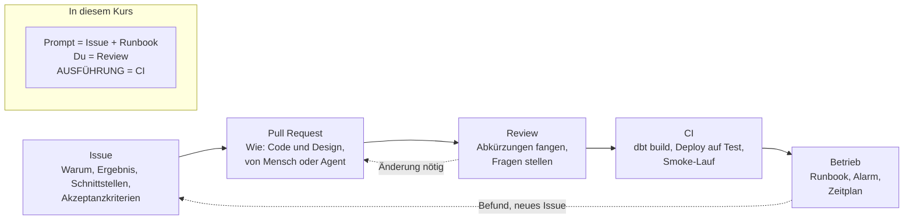

# Die Spezifikation im Team

Die Prompts in diesem Kurs haben vier Teile: was das Ding tun soll, welche Entscheidungen
fest sind, weil andere davon abhängen, was der Agent nicht tun soll, und woran man sieht,
dass es geklappt hat. In einem Team gibt es dieselben vier Teile, aber sie liegen nicht in
einem Chat, sondern an vier Orten, und zwischen ihnen stehen Menschen.

## Vier Orte



**Das Issue** sagt, warum und was. Es nennt Schnittstellen (Tabellennamen, Spalten, Zeitpläne,
Rollen), weil andere Arbeit davon abhängt, und sagt nichts darüber, wie es gebaut wird. Es
endet mit Akzeptanzkriterien, die jemand anderes prüfen kann.

**Der Pull Request** sagt, wie. Wer immer den Code schreibt, Mensch oder Agent, schlägt dort
das Design vor und begründet es. Was in unseren Prompts unter "Nicht tun" steht, braucht es
hier nicht: Abkürzungen fängt das Review.

**Das Review** ist der Mensch zwischen Vorschlag und Repo. Es fragt, ob der Code das Issue
erfüllt, nicht ob er läuft. Dass er läuft, prüft die CI.

**Die CI** ersetzt unsere AUSFÜHRUNG-Punkte. Bei jedem Pull Request läuft `dbt build` gegen
ein Test-Dataset, nach jedem Merge ein Deploy auf eine Testumgebung und ein Smoke-Lauf. Was
wir in der Lektion von Hand abfragen (Zeilenzahlen, Partitionen, Executions), prüft dort ein
Skript.

**Der Betrieb** hat ein Runbook: was der Alarm bedeutet, was man um 11:35 an einem Donnerstag
tut, wenn er kommt. Was dabei auffällt, wird wieder ein Issue.

In diesem Kurs fallen die Orte zusammen, weil zwischen dir und dem Deploy niemand steht:
Der Prompt ist Issue und Runbook in einem, du bist das Review, und die AUSFÜHRUNG-Punkte sind
die CI, von Hand gelesen. Das ist für eine Lektion richtig und für ein Team nicht.

## Ein Issue, wie es im Tracker stünde

Das ist die Verkettung aus Lektion 2, Schritt 5, als Issue geschrieben:

```markdown
# Pipeline verketten: Ingest → Qualitätsschranke → Transform

**Warum.** Heute startet der Scheduler nur den Ingest. Der Transform läuft von Hand, und ein
schlechter Feed landet ungeprüft im Mart. Die drei Teile sollen eine Kette sein, die bei einem
Fehler stoppt und uns benachrichtigt.

**Ergebnis.** Ein Cloud Workflow `gtfs-pipeline` in `europe-west6`, Mo und Do 11:30 vom
Scheduler gestartet, führt aus: `ingest-gtfs`, dann Dataplex-Scan `trips-quality`, dann
`transform-gtfs`. Der Transform läuft nur, wenn der Scan bestanden ist.

**Schnittstellen.** Namen der Jobs und des Scans wie bestehend. Projekt und Region kommen aus
der Umgebung, die Datei ist projektunabhängig. Eigener Service-Account `workflow-sa` mit
Least Privilege. Alter Scheduler-Job `ingest-gtfs-schedule` entfällt.

**Akzeptanzkriterien.**
- [ ] Ein manueller Start läuft durch, Ergebnis nennt Ingest-Execution, Scan-Job, Transform-Execution
- [ ] Scan nicht bestanden → Workflow endet mit Fehler, Transform wird nicht gestartet
      (Test mit einer unerfüllbaren Regel auf einer Kopie des Scans)
- [ ] Fehlgeschlagener Job oder Workflow → E-Mail an das Team innert 10 Minuten
- [ ] Zweiter Lauf derselben Version ändert den Mart nicht
- [ ] `pipeline/README.md` sagt, wie man startet, wo man Executions sieht, was der Alarm meldet

**Nicht Teil davon.** Retries, Parallelität, Snapshot des Marts über Versionen.

Owner: vp · Reviewer: N. N. · Fällig: vor Lektion 2
```

Zwei Dinge fallen auf, wenn man das Issue neben den Prompt aus der Lektion legt.

Das Issue sagt nicht "alle 15 Sekunden abfragen" und nicht "mit dem Connector für Cloud Run".
Das sind Entscheidungen des Pull Requests. Im Prompt stehen sie, weil kein Review dazwischen
ist und der Agent sonst eine Abkürzung nimmt, die erst in der Lektion auffällt.

Das zweite Akzeptanzkriterium, die geschlossene Schranke, fehlt in der Lektion aus Zeitgründen.
Ein Team würde darauf bestehen, denn die Schranke ist das eigentliche Feature. Wer es
nachholen will: eine Kopie des Scans mit einer Regel, die nicht bestehen kann, den Workflow
auf diese Kopie zeigen lassen, starten, und zusehen, wie `check_gate` den Fehler wirft und
`run_transform` nie drankommt.

## Was das für die Prompts in diesem Kurs heisst

Wenn du nach dem Kurs mit einem Coding-Agenten arbeitest, schreib das Issue zuerst, auch
wenn du es nur für dich schreibst. Die vier Teile zwingen dich, die Schnittstellen zu nennen,
bevor der Agent sie erfindet. Dann gib dem Agenten das Issue, nicht eine Beschreibung des
Codes. Und lies den Vorschlag so, wie ein Reviewer ihn lesen würde: Erfüllt er das Issue, und
was hat er ausgelassen.
